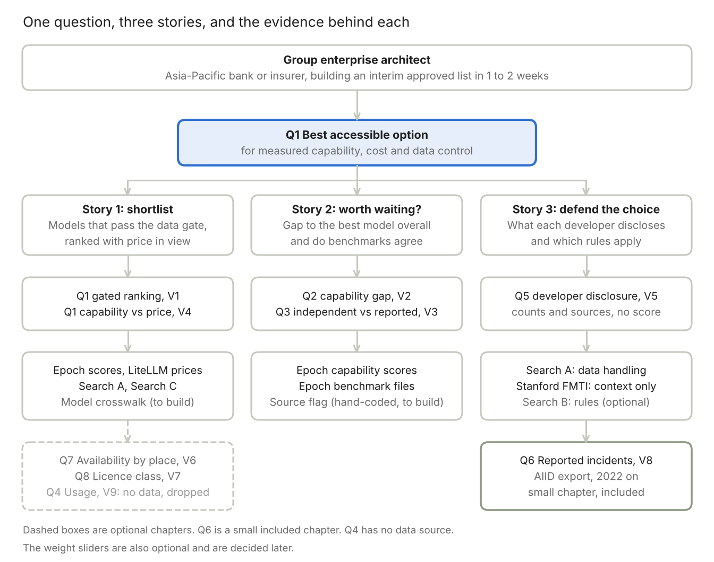

# Final Proposal: AI Model Choice and Data Risk Where Closed US Models Are Restricted

Oct 18, 2026 · @Ian

## Proposal at a glance

We propose a Streamlit data narrative that tells an organisation in Hong Kong or the wider Asia-Pacific which accessible AI model gives the most measured capability for its cost and data-control needs, and lets the reader test how that answer moves when priorities change.

| Item                 | Decision                                                                                                                                                                                                                                                                                    |
|----------------------|---------------------------------------------------------------------------------------------------------------------------------------------------------------------------------------------------------------------------------------------------------------------------------------------|
| Core question (Q1)   | In regions where leading closed US models are restricted, which accessible AI model gives an organisation the most measured capability for its cost and data-control needs?                                                                                                                 |
| Region reading       | "Hedging area" is read as Hong Kong and the wider Asia-Pacific, where access to leading closed US models is restricted or uncertain. The question names no place, so it holds for any restricted region. Hong Kong is the worked example. **To confirm with Ian.**                          |
| Primary persona      | Group enterprise architect at an Asia-Pacific bank or insurer (the only persona)                                                                                                                                                                                                            |
| Weighting (optional) | Optional sliders for capability, cost and data control. Default values and any role presets are to be decided later.                                                                                                                                                                        |
| Core chapters        | Q2 capability gap over time, Q3 independent versus self-reported benchmarks, Q5 developer disclosure and Q1 core question, ranked by feasibility and data quality. Q1 ranks last on feasibility because it needs the model crosswalk, but it is built first because it is the core question |
| Optional chapters    | In priority order: Q7 availability by place, Q8 self-hosted against API-only models and Q6 reported incidents (brought back on 18 October 2026 as a small chapter, built from the AIID export we hold). Q4 real-world usage is dropped unless a usage source is found, because the team struck Wikimedia page views on 18 October 2026 |
| Data backbone        | Epoch AI capability scores, benchmark files and models table, LiteLLM list prices, LMArena ratings, Stanford FMTI scores, the AI Incident Database export, and three hand-coded tables built from provider and regulator pages (availability, data handling, data-protection rules). Ten notebooks in the Data folder rebuild every processed file |
| Charts               | At least four across ranking, correlation, change over time and deviation                                                                                                                                                                                                                   |
| Next date            | Part 1 recording, Friday 23 October 2026, 11:59pm (the Canvas header says 26 October, so confirm with the teaching team)                                                                                                                                                                    |

## Why this topic, and how it differs from the four earlier proposals

The four earlier proposals (P1 to P4, 14 October 2026) all describe the AI field. This one helps a named person make a choice, and that choice is arguable because the answer changes with the weights the person sets.

| Earlier proposal                                    | What it asked                                                                   | What this proposal keeps or changes                                                                                                                 |
|-----------------------------------------------------|---------------------------------------------------------------------------------|-----------------------------------------------------------------------------------------------------------------------------------------------------|
| P1 Compute concentration vs access (feasibility 16) | Is access to frontier-scale models narrowing or spreading through open release? | Keeps the open versus closed split from the Epoch capability file and turns it into an option an organisation can actually use                      |
| P2 Attention vs capability (14)                     | Does public attention follow measured capability?                               | Keeps the Epoch Benchmarking Hub files and uses them for Q3, dropping the Wikipedia page-view series from the core                                  |
| P3 AI energy geography (15)                         | Is AI electricity demand global or local?                                       | Dropped, because energy data does not bear on model choice                                                                                          |
| P4 China compute efficiency (15)                    | Is China keeping pace with less compute?                                        | Keeps the China-versus-US capability comparison from the Epoch capability file, but asks what an organisation can use, not how much compute it took |

Three things are new. Availability by country and provider is coded from provider pages (Search C). Data handling by provider is coded from terms and privacy pages (Search A). Data-protection rules by jurisdiction are coded from regulator and law pages (Search B). These layers turn a league table of models into a decision under constraints.

The risk is that a decision tool is less obviously inside the Assignment 3 question territories than P1 to P4 were. We have not yet confirmed this with the teaching team, so it is listed under open decisions.

## The question, and why it is arguable

> In regions where leading closed US models are restricted, which accessible AI model gives an organisation the most measured capability for its cost and data-control needs?

Alternative wording, with the same meaning, for the group to decide: "Where leading closed US models are unavailable or restricted, which accessible option gives the most measured capability for its cost and data-control needs, and how much does the answer depend on how an organisation weighs those?" It keeps the dependence on weights inside the question, but it reads as two questions. Only one wording goes in the README and on the opening screen, because the brief asks for one question in one sentence. The same data supports two readings, and the app lets the reader move between them with three weight sliders.

| Reading                                                  | What a reader would point to                                                                                                                                                                           |
|----------------------------------------------------------|--------------------------------------------------------------------------------------------------------------------------------------------------------------------------------------------------------|
| **"Accessible open models are close enough."**           | Chinese and other open-weight models sit about 9 points below the best closed model on the Epoch capability index. That gap is about the size of the index's own confidence interval (7 points) and has not narrowed in our file. These models cost little to run and can be self-hosted so data never leaves the organisation. |
| **"The best accessible option depends on who you are."** | When data control or provider disclosure gets a high weight, the ranking changes, because hosted options differ in where data goes and in what the developer discloses.                                |

Q1 is the one question the app answers. Q2 to Q8 are not separate questions. They are evidence chapters, each written as a statement that the chapter tests.

| Rank | Q   | Question                                                                                                                   | Story | View and chart family                     | Data and quality                                                                                                                                                                                                                                                                 | Status                        |
|------|-----|----------------------------------------------------------------------------------------------------------------------------|-------|-------------------------------------------|----------------------------------------------------------------------------------------------------------------------------------------------------------------------------------------------------------------------------------------------------------------------------------|-------------------------------|
| 1    | Q2  | Chapter: how much capability is lost by using only open or non-US-hosted models, and whether the loss has shrunk over time | 2     | V2, change over time                      | Epoch capability scores (277 models to 7 October 2026) and benchmark metadata. Quality high, no cross-dataset join needed. The best-model gap is about 9.4 points and the median confidence interval is 7.1 points wide, so the chapter must show the interval | Core, easiest                 |
| 2    | Q3  | Chapter: how far independently run benchmark scores differ from developer-reported scores, by developer region             | 2     | V3, deviation                             | Epoch benchmark files (5,301 score rows across 61 benchmarks in notebook 07). Quality high, but the independent or self-reported flag is hand-coded, and the source column of processed_data_for_eci.csv (2,898 rows, of which 1,270 are blank, 872 paper or report and 756 URL) must be added back to notebook 07 first | Core                          |
| 3    | Q5  | Chapter: what developers of accessible models disclose about their data practices, and why it matters for the choice       | 3     | V5, part-to-whole with a detail table     | Search A (12 rows, 7 providers) and Search B (4 places), with Stanford FMTI (December 2025, CC-BY-4.0, 13 developers, notebook 08) as context. Quality medium: hand-coded from provider pages, small sample, about half the fields are "not stated" or "not checked" and retention days are missing for 83 percent of rows. FMTI scores how openly a model was built (DeepSeek 32 and Alibaba 26 out of 100), not how customer data is handled, so it does not replace Search A | Core                          |
| 4    | Q1  | Core question: the best accessible model for capability, cost and data control                                             | 1     | V1, ranking, and V4, correlation          | Epoch scores, Search A, Search C and LiteLLM prices. Each source is good, but they need the model crosswalk first. A first-pass exact-name match links 186 of 277 ECI models to LiteLLM, 77 to LMArena and 122 to the benchmark files, and for the top 50 models only 49, 24 and 12, so hand work is needed | Core, built first, hardest    |
| 5    | Q7  | Chapter: which providers are available in which place                                                                      | 1     | V6, XY heatmap (Correlation, a loose fit) | Search C (28 rows, 7 providers), hand-coded with page dates. Quality medium to high, but 16 of 28 rows are "no list found". Not listed and no list found are not the same as restricted | Optional                      |
| 6    | Q8  | Chapter: how much capability is left once the model licence must allow commercial self-hosting                             | 1     | V7, paired bar (Magnitude)                | The Epoch capability file we already hold, which has accessibility and country columns (277 models, 24 with unknown accessibility, 17 with no organisation or country). Quality medium to high. The licence classes are Epoch's labels, and we have read the licence text for five open-weight models only (the other open-weight rows are marked not reviewed) | Optional                      |
| 7    | Q6  | Chapter: which developers' systems appear in reported AI incidents, and whether reports are rising                         | 3     | V8, change over time                      | AI Incident Database weekly export of 12 October 2026 (CC BY-SA 4.0), file held and opened. 1,734 incidents, developer filled for 99.9 percent, dates complete. Quality medium: English-language media, developers are alleged, names are free text and cleaned by our rules, and only 8 incidents over all years name DeepSeek, Alibaba, Z.ai or Moonshot (OpenAI has 190), so the chapter cannot compare regions | Included, small chapter |
| 8    | Q4  | Chapter: whether real-world usage follows capability, price or availability                                                | 1     | V9, correlation                           | No source. Wikimedia page views measure attention and not usage, and the team struck them on 18 October 2026. Quality: none | Dropped unless a source is found |

**When the architect asks each question (assumed situations).** These situations are our assumptions about the persona's work and have not been tested with a real architect. Q4 and Q6 are not tied to a situation.

| Q   | Situation in which the architect asks it (assumed)                                                                                                                   | Story | Primary data                                                    |
|-----|----------------------------------------------------------------------------------------------------------------------------------------------------------------------|-------|-----------------------------------------------------------------|
| Q1  | The risk committee wants an interim approved list within one to two weeks, and the architect must choose which models go on it for the level of data staff will send | 1     | Epoch ECI, Search A, Search C, LiteLLM prices                   |
| Q2  | Before committing, the architect must tell the committee whether waiting for US access is worth it                                                                   | 2     | Epoch ECI, benchmark model_metadata.csv                         |
| Q3  | The committee is quoting developer claims, and the architect needs to know whether independent tests agree before relying on a number                                | 2     | Epoch benchmark file processed_data_for_eci.csv                 |
| Q5  | A regulator or auditor asks how the choice was made, and the architect must show what each developer discloses and which rules apply                                 | 3     | Search A, Search B, regulator pages (HKMA, APRA, MAS)           |
| Q7  | Some staff already use a hosted model, and the architect must check that the provider is really offered where the bank operates                                      | 1     | Search C                                                        |
| Q8  | The committee asks whether a self-hosted open-weight model may be used commercially, since the data then stays inside the bank                                       | 1     | Epoch ECI accessibility columns, then the official licence text |

## How the questions and data fit together

question tree · persona, Q1, three stories, data

Read from the top. The persona asks the one question, Q1. The three stories are the three walks through the app, each story rests on its own chapters and views, and each chapter names the data behind it. Dashed boxes are optional chapters, the small solid box is Q6, and Q4 is grey because it has no data source.

## Persona, value linkage and rationale

This proposal serves one persona, the group enterprise architect described in the next section. The persona is defined by identity and role, not by name. The ratings below are our own assumptions and are not from user research. Seven other roles were considered earlier and are kept in the Round 1 brief for reference.

The value linkage rates how essential each question is to the architect, on four levels. It sets which chapters we build first.

| Question                                   | Rating for the architect | Reason                                                    |
|--------------------------------------------|--------------------------|-----------------------------------------------------------|
| Q1 Core question                           | Essential                | The approved list is the decision the architect must make |
| Q2 Capability gap over time                | High                     | Shows what is given up and whether waiting is worth it    |
| Q3 Independent versus self-reported scores | High                     | Tests whether the capability numbers can be trusted       |
| Q4 Real-world usage                        | Medium                   | Useful context, not needed to approve a list              |
| Q5 Developer disclosure                    | High                     | Needed to defend the choice to the regulator              |
| Q6 Reported incidents                      | Medium                   | Useful context, and the AIID export is now in hand        |

Rationale for the build order:

- Q1 is Essential, so it is the core question.

- Q2, Q3 and Q5 are rated High, so they are core chapters. Q3 also uses files we already hold.

- Q4 is rated Medium and now has no data source, so it is dropped unless one is found. Q6 is also rated Medium and was brought back as a small chapter on 18 October 2026 because its data is in hand. Q7 and Q8 were added later as optional chapters and are not yet rated.

- One persona keeps the app focused. Another role would change the data level and the priorities, not the data we need.

Weighting (optional, to be decided later). The app may offer three sliders for capability, cost and data control, with equal weights as the neutral default. Role presets and their numbers are left for the group to discuss once the data is joined.

## Primary persona, scenario and three user stories

**Persona:** group enterprise architect at an Asia-Pacific bank or insurer with operations in Hong Kong and other markets. The persona is defined by identity and role and has no personal name.

**Scenario.** The risk committee has asked for an approved list of AI models for staff and internal tools. The leading closed US models are not offered in Hong Kong. The committee wants an interim list within one to two weeks. The architect must choose among regionally hosted services (a provider runs the model in a chosen region), non-US hosted services (a provider outside the US runs it) and self-hosted open weights (the organisation runs the model on its own servers). The committee will ask what capability is given up, where the data goes, and which level of data each option may handle.

**Task.** Produce an interim approved list. For each candidate model, say whether it is approved, by which route, and for which level of data: public information, internal business data or customer personal data.

**Constraints (assumed, to validate with the group).** Time: one to two weeks. The list is interim, so it is reviewed when provider terms change, when US access changes or when a stronger accessible model appears, and each version is kept with its date, data level and sources. Organisation: the committee needs reasons, not a single score. Data: data control and availability are coded by us from provider pages, not measured, and the pages change. Scope: financial-sector regulator rules, performance on the organisation's own tasks and security review are not covered by the app.

| Decision the architect faces                    | View that supports it                                                           | What the architect can act on                                         |
|-------------------------------------------------|---------------------------------------------------------------------------------|-----------------------------------------------------------------------|
| Which accessible models go on the approved list | V1 ranked options with the data-level selector, and V4 capability against price | The top options under the committee's weights                         |
| Is waiting for US access worth it               | V2 capability gap over time and V3 independent versus self-reported scores      | How much capability is lost and whether the gap is shrinking          |
| Can the choice be defended to the regulator     | V5 developer data handling and the jurisdiction notes                           | An audit trail of what each developer discloses and which rules apply |

| \#  | User story                                                                                                                                                                                                                                                           | Walk-through in the app                                                                                        |
|-----|----------------------------------------------------------------------------------------------------------------------------------------------------------------------------------------------------------------------------------------------------------------------|----------------------------------------------------------------------------------------------------------------|
| 1   | As a group enterprise architect, I want to set the level of data staff will send and shortlist the accessible models that pass the data gate, ranked with capability set against price, so that I can build an interim approved list the risk committee will accept. | V1 with the data-level selector, V4 for capability against price, and the optional sliders and region selector |
| 2   | As a group enterprise architect, I want to measure how far the best accessible model trails the best model overall and check whether independent benchmarks agree with developer claims, so that I can judge whether waiting for US access is worth it.              | V2 and V3 with the date range and the region filter                                                            |
| 3   | As a group enterprise architect, I want to review what each developer discloses about its data practices and trace which jurisdiction's rules apply, so that I can show the regulator how the choice was made.                                                       | V5 with the developer filter, plus the sourced notes on the data-protection rules                              |

**Acceptance criteria.** Written before building and tested on the finished screen.

- Story 1. The app opens with a ranking of all accessible options. After the reader picks a data level, options that fail the data gate are removed, with the reason and the source page shown. The ranking updates within about one second when a control changes. A filter with no result shows a message, not a blank.

- Story 2. The app shows the best accessible model against the best model overall by release date, with units and time range stated. It shows independent against self-reported scores by developer region, with coverage stated. It says that the data cannot predict when US access returns.

- Story 3. The reader can filter by developer and see each coded data-handling term with its source page and date. The jurisdiction notes show their source type (law, regulator page or law-firm summary). The app says it gives no legal advice.

**Interface checks from the lecture.** Taken from the Users and Interfaces slides (Nielsen's heuristics, Shneiderman's mantra and the latency budget).

- System status: show a count after every filter, for example "4 of 9 options pass the data gate".

- Familiar language: use plain labels such as "capability score", not file column names.

- Control and freedom: a reset button, and filters that can be cleared.

- Error prevention: only valid data levels and regions can be chosen.

- Recognition: the current filters stay visible on screen.

- Overview first, then filter, then details: V0 gives the overview, the selectors filter, and a click on a model opens its coded row and source page.

- Response: the screen updates within about one second after each change, and an empty result is explained, never blank.

## Data and deep-research findings

Of 20 candidate datasets drawn from the four earlier proposals and our own searches, 5 are compulsory, 7 are optional and 8 are dropped. The Epoch AI files carry the capability side, three hand-coded tables carry availability, data handling and data-protection rules, and ten notebooks in the Data folder rebuild the processed tables.

### Dataset ranking (top fourteen)

Score = 3 × fit + held + licence + effort, each factor 0 to 3, maximum 18. Fifteen or more is compulsory, 12 to 14 is optional, below 12 is dropped. The full 20-row table is in the dataset usage document, re-scored on 18 October 2026 now that the LiteLLM, LMArena, FMTI and AIID files are held and opened.

| Dataset                                                      | Score | Tier               | Questions it serves |
|--------------------------------------------------------------|-------|--------------------|---------------------|
| Epoch Capabilities Index scores                              | 18    | Compulsory         | Q1, Q2, Q8          |
| Search A: provider data handling (hand-coded)                | 17    | Compulsory         | Q1, Q5              |
| Search C: provider availability by country (hand-coded)      | 17    | Compulsory         | Q1, Q2, Q7          |
| LiteLLM model prices                                         | 17    | Compulsory         | Q1 (cost)           |
| Epoch Benchmarking Hub files                                 | 16    | Compulsory         | Q2, Q3              |
| LMArena ratings                                              | 14    | Optional           | Q1 cross-check, Q2  |
| Epoch per-benchmark CSVs                                     | 14    | Optional           | Q1, Q3              |
| Stanford FMTI, December 2025 (opened, notebook 08)           | 14    | Optional           | Q5 context          |
| Search B: data-protection rules by jurisdiction (hand-coded) | 13    | Optional           | Q1, Q5 context      |
| AI Incident Database (export of 12 October 2026, notebook 10) | 13   | Optional, included | Q6                  |
| Financial-regulator pages (HKMA, APRA CPG 230, MAS FEAT)     | 12    | Optional           | Q5 rules note       |
| Epoch AI models CSV (notebook 09)                            | 12    | Optional           | Q2 context          |
| Wikimedia page views                                         | 12    | Dropped by team decision, 18 October | Q4 proxy |
| AIAAIC Repository (OECD entry only)                          | 8     | Not needed         | Q6 fallback         |

### What the files and searches show so far

- **Capability (Epoch, file of 7 October 2026).** The Epoch Capabilities Index file holds 277 models released from 24 February 2023 to 7 October 2026, with country, accessibility group and a confidence interval. Of 76 models from Chinese developers, 63 have open weights. The top model overall is Claude Opus 5.5 at 166.82 and the top model from a Chinese developer is Kimi K3 at 157.42, a gap of about 9.4 points, which is close to the 7.1-point median confidence interval. Qwen 3.8 Max (156.88, API only), GLM-5.3 (155.91, API only) and DeepSeek V4 Pro 0813 (155.29, open weights) follow closely.

- **Availability (Search C, 28 rows, seven providers).** The OpenAI, Anthropic and Google Gemini API pages do not list Hong Kong or mainland China among supported places but do list Singapore and Taiwan. DeepSeek and Alibaba Model Studio publish no country list, and 16 of the 28 rows are "no list found". Z.ai and Kimi exclude only sanctioned places. Alibaba Model Studio offers Hong Kong and Singapore regions.

- **Data handling (Search A, 12 rows, 7 providers).** Each row records the contracting entity, governing law and data-handling terms from the provider's own pages, so the data-control weight rests on a sourced table, not an opinion. About half the fields are "not stated" or "not checked", and the app shows those as their own class.

- **Rules (Search B).** Hong Kong's cross-border transfer rule (PDPO section 33) is still not in operation and PCPD model clauses are voluntary. Mainland China's PIPL sets transfer routes by data volume. Singapore requires comparable protection abroad. Taiwan's amendment is promulgated but its start date was not set as of 13 January 2026.

### Gaps that remain

Q4 usage share and price history have no confirmed open source. OpenRouter's OP.GG page covers one app only and has no licence, so it was rejected, and the team struck Wikimedia page views on 18 October 2026 because they measure attention and not usage, so Q4 has no data source now. For Q5 there is still no ready-made score of customer data handling. Stanford's Foundation Model Transparency Index (December 2025, CC-BY-4.0, 13 developers, 100 indicators) scores how openly a model was built, so it is context only. Its files were read on 18 October 2026 in notebook 08, where IBM (95) and Writer (72) lead and DeepSeek (32) and Alibaba (26) sit near the bottom. Q6 uses the AI Incident Database weekly export (CC BY-SA 4.0, export of 12 October 2026, opened on 18 October 2026: 1,734 incidents, developer field 99.9 percent filled, incidents per year rising from 109 in 2022 (the year ChatGPT launched) to 457 in 2025, and the chapter starts at 2022). It names OpenAI in 190 incidents but DeepSeek, Alibaba, Z.ai and Moonshot in only 8 together, so it cannot compare China-based developers, and AIAAIC is no longer needed. The OECD AI Incidents Monitor and Inhumain were rejected because of licence and provenance. Q8 needs no new file, because the Epoch capability file we hold already has accessibility columns. On 18 October 2026 it showed the best closed-weights model at 166.82 (Claude Opus 5.5), the best open-weights model at 157.42 (Kimi K3, labelled non-commercial by Epoch) and the best unrestricted open-weights model at 155.29 (DeepSeek V4 Pro 0813). We opened the licence pages of five open-weight models on 18 October 2026 (see the V7 table), and the other open-weight rows are marked not reviewed. Epoch states that its benchmarking data is free to use with credit under CC BY 4.0 (checked on 18 October 2026, and the ECI chart page itself is still to be checked). LiteLLM gives current prices only, and its licence was checked on 18 October 2026 (MIT, enterprise/ folder excluded). The Epoch models CSV has a notebook (09) but it has not yet run on the real file, because scripted downloads from epoch.ai are blocked in our environment. Mistral, Meta and Google open-weight developers, MiniMax in Search A, and cloud-reseller routes in Hong Kong and Singapore are not yet covered. For Q5 we opened the HKMA (15 October 2026), APRA CPG 230 and MAS FEAT pages, and a team member checked the addresses of both PCPD PDFs (AI protection framework and use of agentic AI, both CC BY 4.0). The MAS general terms address is recorded but its text is unread, and Taiwan is not covered, so Search B still leans on law-firm summaries that are labelled as such.

### Data quality and difficulty by question

We checked every processed table on 18 October 2026. The table ranks the questions from easiest to hardest to build, with the rows each one uses and the main missing data. Row counts are table sizes and not all rows are used by every chart.

| Question | Difficulty | Rows it uses | Main missing data and limits |
|----------|------------|--------------|------------------------------|
| Q2 Capability gap | Easy, feasible now | 277 ECI models | Organisation and country missing for 17 models (6.1 percent), so a name-based China fallback is wanted. Gap of 9.4 points against a 7.1-point confidence interval |
| Q8 Self-hosted licences | Easy to medium | 277 ECI models | 24 models with unknown accessibility. Licence text read for five open-weight models only, 150 rows marked not reviewed |
| Q7 Availability by place | Medium | 28 Search C rows | 16 of 28 rows are "no list found" (57 percent), which is not the same as restricted |
| Q5 Developer disclosure | Medium | 12 Search A rows, 4 Search B places, 1,300 FMTI scores | About half the fields are "not stated" or "not checked". Retention days missing for 83 percent of rows. Small sample |
| Q6 Reported incidents | Medium | 1,734 incidents (1,310 from 2022 on), 3,068 incident-developer rows | English-language media, alleged developers, free-text names. 2026 is partial (to 3 October). Only 8 incidents name the China-based developers in scope |
| Q3 Independent versus self-reported | Medium to hard | 5,301 score rows in 61 benchmarks | Source column (in the 2,898-row processed_data_for_eci.csv) is 1,270 blank, 872 paper or report and 756 URL, and must be added back to notebook 07 and coded by hand |
| Q1 Core question | Hardest, needs the crosswalk | 277 ECI models joined to prices, ratings and developer terms | Exact-name matches reach 186 (LiteLLM), 77 (LMArena) and 122 (benchmarks) of 277, and for the top 50 only 49, 24 and 12. About 40 to 90 recent candidates have a Search A developer and 30 to 40 can be plotted |
| Q4 Real-world usage | Not feasible | None | No usable source |

If Searches A, B and C were not used, Q1 would lose its data-control and availability layers and become a capability-and-price league table, Q5 and Q7 would have no data, and Q2 and Q3 would still stand on the Epoch files alone.

### Dataset issues and limitations found in testing

The issues below come from running notebooks 01 to 10 and checking every processed table on 18 October 2026. They are the reasons the build order puts Q1 last and Q4 out.

| # | Issue found in testing | Datasets affected | Effect on questions | What we do |
|---|------------------------|-------------------|---------------------|------------|
| 1 | Model names differ across sources. Exact-name matches of the 277 ECI models reach 186 (LiteLLM), 77 (LMArena) and 122 (benchmark files), and for the top 50 models only 49, 24 and 12 | ECI, LiteLLM, LMArena, benchmark files, Search A | Q1 most, also Q3 | Build the crosswalk by hand, show the match rate on screen, plot only matched models |
| 2 | One publisher sits under most numbers | ECI, benchmark files, Epoch models CSV | Q1, Q2, Q3, Q8 | Say so on screen, use LiteLLM and LMArena as independent views |
| 3 | Hand-coded tables are small and go stale (Search A 12 rows, Search C 28, Search B 4 places) | Search A, B, C | Q1, Q5, Q7 | Show the page date on every row, recheck before submission, say "coded from the page of [date]" |
| 4 | Many fields are empty or "not stated": about half of Search A fields, retention days missing for 83 percent of rows, 16 of 28 Search C rows "no list found", LiteLLM supported_regions empty for 99.6 percent | Search A, Search C, LiteLLM | Q5, Q7, Q1 | Show them as their own class and never as pass or fail. Do not use the LiteLLM region field |
| 5 | The source column that separates independent from self-reported scores is not kept in notebook 07 (in the 2,898-row processed_data_for_eci.csv, 1,270 blank, 872 paper or report, 756 URL) | Benchmark files | Q3 | Add the column back, build the source map by hand, drop Q3 to a smaller chart if coverage is thin |
| 6 | 17 of 277 ECI rows (6.1 percent) have no organisation or country | ECI | Q2, Q8 | Name-based China fallback, label the rest unknown |
| 7 | Licence text read for five open-weight models only, 150 rows are not reviewed, and Epoch's label can differ from the licence (Kimi K3) | ECI, licence pages | Q8 | Read more licence texts, show Epoch's label beside ours, state it is not legal advice |
| 8 | LiteLLM gives current API list prices only. It has no price history and no self-hosting cost | LiteLLM | Q1 | State on screen that price means API list price |
| 9 | AIID country code is filled for 143 of 1,734 incidents (about 8 percent), none for Hong Kong and 4 for China. Developers are alleged, names are free text, 2026 is partial, and only 8 incidents name the China-based developers in scope | AI Incident Database | Q6 | No regional map and no regional comparison, show rising reports only |
| 10 | FMTI scores how openly a model was built, not how customer data is handled | Stanford FMTI | Q5 | Context only, never a data-control score |
| 11 | No usage source after Wikimedia page views were struck | None | Q4 | Drop Q4 unless a source is found |
| 12 | Downloads from epoch.ai, Hugging Face, the GitHub archive and the AIID host are blocked from our cloud environment, and notebook 09 has only run on made-up data | Epoch models CSV, LMArena, FMTI, AIID | Q2 context | Run on a team machine and save files by hand under Data/raw if blocked |

If Searches A, B and C were all given up, Q7 would disappear, Q5 would lose its core and the data gate and availability layers of Q1 would go, so the core question would have to be reworded around self-hosting feasibility. The persona and the three-story structure can stay. The group can decide this with the separate Alternative Proposal (No Search ABC), which is written on the same template.

### Deep research with Gemini

We wrote a Deep Research brief, ran three Gemini rounds and checked the outputs. Gemini's reports copied text from our older proposals, labelled unverified claims as verified, guessed some URLs, left citation markers in the text and misdescribed some datasets. We therefore used Gemini only as a pointer list and built Searches A, B and C by hand from opened pages. Round 3 asked only for source leads and chart ideas. Gemini marked all 14 pages as opened, so we opened each one ourselves: the FMTI page and licence, the HKMA, APRA and MAS pages and the Epoch data page passed, and Gemini was wrong that FMTI has no licence. The OECD incidents monitor, Inhumain and OpenRouter OP.GG were rejected, and a team member later supplied and checked the two PCPD PDF addresses. The Deep Research documentation records each file and the decision.

## Pipeline, app files and views

The app follows the Assignment 2 Part C folder standard: a pipeline in src/data.py that acquires, shapes and validates the data, charts in src/views.py, small real samples in data/sample, processed files in data/processed, and three documents in docs. Every processed file must rebuild offline from the samples. Manual downloads are allowed if documented.

| Processed file | Built from | Notebook | Status | Used by |
|----------------|------------|----------|--------|---------|
| model_capability.csv | Epoch capability scores, one row per model, with our licence class | 01 | Built | V1, V2, V7 |
| provider_data_handling.csv | Search A (12 rows) | 02 | Built | V1, V5 |
| provider_availability.csv | Search C (28 rows) | 03 | Built | V1, V6 and the region selector |
| model_price.csv | LiteLLM list prices, current only | 04 | Built | V1, V4 |
| jurisdiction_rules.csv, jurisdiction_sources.csv, financial_regulator_pages.csv | Search B | 05 | Built | Notes beside V5 |
| lmarena_ratings.csv | LMArena text leaderboard | 06 | Built | Cross-check on V1 and V2 |
| benchmark_scores.csv, benchmark_catalogue.csv, benchmark_model_metadata.csv | Epoch Benchmarking Hub | 07 | Built, source column to be added back | V3 |
| fmti_indicator_scores.csv, fmti_company_scores.csv, fmti_indicators.csv | Stanford FMTI, December 2025 | 08 | Built | Context beside V5 |
| ai_models.csv, ai_models_columns.csv | Epoch AI models table | 09 | Notebook written, not yet run on the real file | Q2 context |
| incidents.csv, incident_developers.csv, incidents_by_developer_year.csv, incidents_by_year.csv | AI Incident Database export, incident-level fields only | 10 | Built, with a first Q6 chart | V8 |
| model_crosswalk.csv | Hand-made map between Epoch, LiteLLM, LMArena and Search A names | None yet | Not built, the biggest Q1 risk | V1, V4 |
| benchmark_source_map.csv | Hand-coded independent or self-reported flag | None yet | Not built | V3 |

The Benchmarking Hub source column is blank, a paper or report, or a URL (1,270, 872 and 756 of 2,898 rows), and notebook 07 does not yet keep it. The independent versus self-reported flag therefore needs the column added back and a hand-made map, and it is the main build risk for Q3.

| View                                  | Question | Visual task                                                                                                                                     | Chart family                                                                | Status                  |
|---------------------------------------|----------|-------------------------------------------------------------------------------------------------------------------------------------------------|-----------------------------------------------------------------------------|-------------------------|
| V0 Opening                            | All      | The question plus one true statement about the whole dataset, for example the number of models and the date range                               | Text and tiles                                                              | Core                    |
| V1 Ranked options                     | Q1       | Which accessible options pass the data gate and rank highest                                                                                    | Ranking, with a data-level selector, optional sliders and a region selector | Core                    |
| V2 Capability gap over time           | Q2       | Best accessible model against best model overall by release date                                                                                | Change over time                                                            | Core                    |
| V3 Independent versus self-reported   | Q3       | Gap between a model's independent score and its developer-reported score, by developer region                                                   | Deviation                                                                   | Core                    |
| V4 Capability against price           | Q1       | How much capability each price buys, for the models that pass the data gate                                                                     | Correlation                                                                 | Core                    |
| V5 Developer data handling            | Q5       | For each developer, how many checks pass, fail or are not stated, with a detail table and sourced rule notes                                    | Part-to-whole, with a detail table                                          | Core                    |
| V6 Availability by place              | Q7       | Which providers are supported, not listed or excluded in each place                                                                             | XY heatmap (Correlation, a loose fit because colour shows a status)         | Optional                |
| V7 Capability by licence class        | Q8       | Best score in each access and licence class: API access, unrestricted open weights, restricted-use open weights and non-commercial open weights | Paired bar (Magnitude)                                                      | Optional                |
| V8 Reported incidents                 | Q6       | Reported incidents by alleged developer over time                                                                                               | Change over time                                                            | Included, small chapter |
| V9 Usage against capability and price | Q4       | Whether usage follows capability, price or availability                                                                                         | Correlation                                                                 | Dropped, no data source |

**How V7 reads the licences (Q8).** Q8 only asks about one way of using a model: the bank downloads open weights and runs them on its own servers. The classes come from the licence text we read on 18 October 2026, with Epoch's label shown beside ours. Epoch labels Kimi K3 as non-commercial, but its licence allows commercial use with a Model as a Service revenue condition, so the two can differ.

| Way of using the model | Which rules apply | Q8 reading |
|---|---|---|
| A. Staff use the provider's own API or website | Provider terms (Search A): retention, training, location | Outside Q8. Covered by the Q5 chapter |
| B. The bank runs open weights itself, for its own staff | Model licence | In Q8. Kimi K3 and Qwen3.8-Max exempt internal use from their revenue clauses. MiniMax M3 has no stated internal-use exemption, so its notice, attribution and military-use rules apply |
| C. The bank gives the model's answers or capability to customers or other outsiders, or a vendor hosts it for the bank | Model licence for whoever offers the service, plus that party's terms | Q8 flags it as not internal. A customer chatbot may count as a third party getting outputs, so legal must confirm |

Classes used in V7: MIT (DeepSeek V4, GLM-5, page field only), custom licence with revenue or user thresholds (Kimi K3, Qwen3.8-Max, MiniMax M3), and API only. This is our reading of the licence text, not legal advice.

Licence pages behind these classes:

| Model or item | Page opened on 18 October 2026 |
|---|---|
| Kimi K3 | https://huggingface.co/moonshotai/Kimi-K3 , https://github.com/MoonshotAI/Kimi-K3/blob/main/LICENSE |
| DeepSeek V4-Pro | https://huggingface.co/deepseek-ai/DeepSeek-V4-Pro |
| GLM-5 | https://huggingface.co/zai-org/GLM-5 |
| Qwen3.8-Max (Qwen3.8-2.4T-A95B) | https://huggingface.co/Qwen/Qwen3.8-2.4T-A95B |
| MiniMax M3 | https://huggingface.co/MiniMaxAI/MiniMax-M3 |
| LiteLLM price file | https://github.com/BerriAI/litellm/blob/main/LICENSE |
| MIT, in general | https://choosealicense.com/licenses/mit/ |
| Epoch accessibility labels | https://epoch.ai/blog/open-models-report |

The core build gives five charts in five families (ranking in V1, change over time in V2, deviation in V3, correlation in V4 and part-to-whole in V5), which meets the minimum of four charts across three families. The optional views V6, V7 and V8 are added only if time allows and none is needed for the minimum, and V9 is dropped because Q4 has no data source. Checked against the FT Visual Vocabulary, V7 is a paired bar (Magnitude), and V6 has no exact match, so it is drawn as an XY heatmap (Correlation) and not counted. The data-level selector, the region selector, the date range and the developer filter are the interactions, and the minimum is two.

## What the app says, and its limits

**Answer (draft wording).** "Under the default weights, the top accessible option for \[region\] is \[model\], which scores \[x\] on the Epoch Capabilities Index against \[y\] for the best model overall, a gap of \[z\] points. The gap has \[shrunk / not shrunk\] since \[year\]. If data control is weighted at \[w\], the top option changes to \[model\]."

**What the data cannot show.**

- Data control and availability are coded by us from provider and regulator pages, not measured by any dataset, and the pages change often.

- The Epoch Capabilities Index combines benchmarks with its own weighting, covers 277 models, and capability and country both come from one publisher.

- The best-model gap in Q2 is about 9.4 points and the index's own confidence interval is about 7 points wide, so the app shows the interval and does not claim the gap is shrinking or growing.

- Q6 rests on English-language media with developers as alleged by reporters. 2026 is a partial year, the generative-AI flag is a keyword rule and a lower bound, and only 8 incidents name the China-based developers in scope, so the chapter shows rising reports and cannot compare regions.

- Benchmark scores do not measure usefulness for a given business task.

- Prices are current list prices only, so price over time is not shown.

- Distillation and ban-risk material is shown only as dated, sourced allegations and never as a chart measure.

- Timing does not show cause, and the app gives no legal advice.

**Wording rules.** Say "coded from the provider's page of \[date\]", not "verified". Say "alleged by" for distillation claims. Say "not listed" where a provider's page omits a place, not "banned". The app contains no instructions for bypassing access controls.

## Requirements, risks, open decisions and next steps

| Assignment 3 requirement                                    | How the proposal meets it                                                                                  |
|-------------------------------------------------------------|------------------------------------------------------------------------------------------------------------|
| One-sentence question on the opening screen                 | Q1, shown in V0                                                                                            |
| Named persona and three user stories                        | Group enterprise architect, three stories walkable in V1 to V5                                             |
| Numbers traceable to files                                  | Every number comes from a processed file built from a dated sample, and the crosswalk files are documented |
| Answer and limits                                           | The answer and limits sections above                                                                       |
| At least four charts across three families                  | V1 to V5 give five charts in ranking, correlation, change over time, deviation and part-to-whole           |
| Two or more interactions, empty-filter message              | Sliders, region selector, date range and developer filter                                                  |
| Sources and latest refresh on screen                        | Shown beside each view, with the latest observation date of each file                                      |
| Data folder, data dictionary, provenance matrix, disclosure | Standard folder from Assignment 2 Part C, one dictionary entry per dataset, one provenance row per member  |

| Risk                                                                     | How we handle it                                                                                        |
|--------------------------------------------------------------------------|---------------------------------------------------------------------------------------------------------|
| Data risk and availability are coded, not measured                       | Call it "data control", define the classes, cite a source and date per row, and say so on screen        |
| Availability pages go stale                                              | Show each page date and re-check every page before submission                                           |
| Q3 needs a hand-made independent versus self-reported flag               | Build the map early and drop Q3 to a smaller chart if coverage is thin                                  |
| Model names differ across Epoch, LiteLLM, LMArena and Search A | Build the crosswalk by hand, show the match rate on screen and plot only models that match |
| Many fields in the hand-coded tables are "not stated" or "not checked" | Show them as their own class and never count them as pass or fail |
| Q4 has no data source, Q5 has no ready-made score and Q6 names almost no China-based developers | Drop Q4 unless a source is found, show Q5 as counts and sourced facts from the Search A table, state the Q6 limit on screen and compare only developers with enough incidents |
| Eight chapters are too many                                              | Build Q1, Q2, Q3 and Q5 first                                                                           |
| Sensitive topic                                                          | Frame as policy and market analysis with no bypass instructions                                         |

**Open decisions for Ian**

- [ ] Confirm that "hedging area" means Hong Kong and the wider Asia-Pacific, with Hong Kong as the worked example.

- [ ] Confirm with the teaching team that a model-choice decision tool fits an Assignment 3 question territory.

- [ ] Confirm the Part 1 due date (Friday 23 October or Monday 26 October 2026).

- [ ] Decide which optional chapters (Q7 and Q8) the group wants. Q4 has no data source since Wikimedia page views were struck on 18 October 2026, so confirm that Q4 is dropped unless a usage source appears. Q6 was brought back on 18 October 2026, confirm with the group.

**Next steps**

1.  Run notebooks 01 to 10 once on a team machine. Notebook 09 has only been tested on made-up data, and scripted downloads from epoch.ai were blocked in our cloud environment, so save the file by hand into Data/raw/epoch if needed.

2.  Build the model crosswalk (Epoch, LiteLLM, LMArena, Search A) by hand in a new notebook, with a match-rate report.

3.  Add the source column back to notebook 07 and build the benchmark source map.

4.  Add a name-based China fallback for the 17 ECI rows with no organisation or country.

5.  Read the MAS general terms (address recorded, text unread) and check the Creative Commons version on the Epoch ECI chart page.

6.  Check the Zhipu and Kimi China-site availability pages and add MiniMax to Search A.

7.  Write the data dictionary, provenance matrix and disclosure drafts.

## References and linked documents

Our working documents behind this proposal:

- [Deep Research Brief: AI Model Choice Where Closed US Models Are Restricted](https://claude.ai/code/artifact/960cbe86-f030-441c-9704-73b7a8136744) (personas, question table, risks)

- [Deep Research Brief Round 2: Corrections and Rework](https://claude.ai/code/artifact/b46999cc-531d-49e6-8666-65cdcd04bb34)

- [Search A: provider data handling](https://claude.ai/code/artifact/3b7002b1-1b18-487e-a827-3891201e23c9)

- [Search B: data-protection rules by jurisdiction](https://claude.ai/code/artifact/6ca3e9a3-46dd-43a1-8c0d-bd406d868e47)

- [Search C: provider availability by country](https://claude.ai/code/artifact/31eae3cc-c885-48b3-9d45-f21d24532783)

- [Dataset inventory and ranking from four earlier proposals](https://claude.ai/code/artifact/6f452402-46ac-4a6a-8c4e-8e4a3068ac3e)

Data sources opened for this proposal:

- [Epoch AI data page](https://epoch.ai/data) (capability index and benchmark files, CC BY 4.0, files retrieved 14 October 2026)

- [OpenAI supported countries](https://developers.openai.com/api/docs/supported-countries)

- [Anthropic supported countries](https://www.anthropic.com/supported-countries)

- [Google Gemini API available regions](https://ai.google.dev/gemini-api/docs/available-regions)

- [Stanford Foundation Model Transparency Index, December 2025](https://crfm.stanford.edu/fmti/December-2025) (CC-BY-4.0, files read 18 October 2026)

- [AI Incident Database snapshots](https://incidentdatabase.ai/research/snapshots/) (CC BY-SA 4.0, weekly export of 12 October 2026)

- [PCPD: AI protection framework](https://www.pcpd.org.hk/english/resources_centre/publications/files/ai_protection_framework.pdf) and [PCPD: use of agentic AI](https://www.pcpd.org.hk/english/resources_centre/publications/files/pcpd_use_of_agentic_ai.pdf) (addresses supplied and checked by a team member, CC BY 4.0)

The full reference lists, with read or not-read status for every regulator and provider page, are in Searches A, B and C. Earlier team files used: the four proposal files and 00_Proposals_Overview.md in the Assignment 3 Proposals folder, and the Assignment 3 Part 1 and Part 2 briefs.
