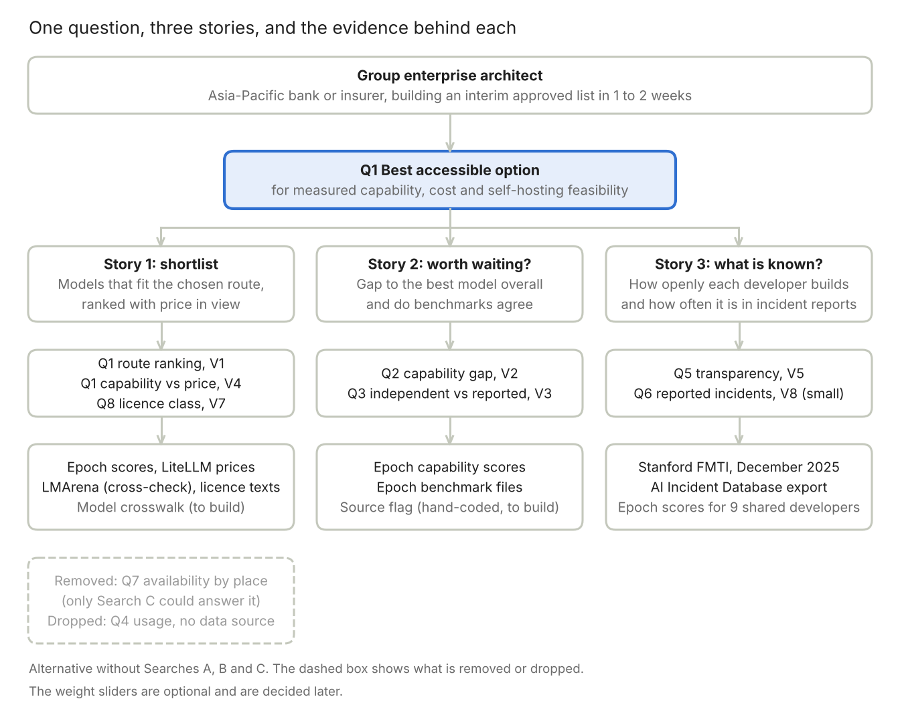

# Alternative Proposal (No Search ABC): AI Model Choice and Self-Hosting Feasibility Where Closed US Models Are Restricted

Oct 18, 2026 · @Ian

## Proposal at a glance

This is the fallback to use if the group gives up Searches A, B and C together. It keeps the same persona and the same three-story structure as the Final Proposal. It changes the core question so that every claim rests on data we hold and have tested, and it replaces the hand-coded "data control" layer with a measured one: whether a model has open weights and a licence that allows self-hosting.

| Item                 | Decision                                                                                                                                                                                                                                                                  |
|----------------------|---------------------------------------------------------------------------------------------------------------------------------------------------------------------------------------------------------------------------------------------------------------------------|
| Core question (Q1)   | In regions where leading closed US models are restricted, which accessible AI model gives an organisation the most measured capability for its cost and self-hosting feasibility?                                                                                        |
| Region reading       | "Hedging area" is read as Hong Kong and the wider Asia-Pacific. The restriction is the starting situation of the story and is not measured, because Search C is given up. **To confirm with Ian.**                                                                       |
| Primary persona      | Group enterprise architect at an Asia-Pacific bank or insurer (unchanged, the only persona)                                                                                                                                                                              |
| Weighting (optional) | Optional sliders for capability, cost and self-hosting feasibility. Defaults to be decided later.                                                                                                                                                                         |
| Core chapters        | Q2 capability gap over time, Q8 self-hosting by licence class, Q3 independent versus self-reported benchmarks, Q5 developer transparency, and Q1 core question. Q1 is built first because it is the core question, and it is lighter than in the Final Proposal           |
| Small chapter        | Q6 reported incidents, built from the AIID export we hold, joined to developer transparency                                                                                                                                                                              |
| Removed or dropped   | Q7 availability by place (only Search C could answer it). Q4 real-world usage (no source). The original Q5 on data handling and the Search B rules notes                                                                                                                  |
| Data backbone        | Epoch capability scores, benchmark files and models table, LiteLLM list prices, LMArena ratings, Stanford FMTI scores, the AI Incident Database export, and licence texts read by hand. Notebooks 01, 04, 06, 07, 08, 09 and 10 rebuild the files                       |
| Charts               | Six core charts across ranking, correlation, change over time, deviation and magnitude                                                                                                                                                                                   |
| Next date            | Part 1 recording, Friday 23 October 2026, 11:59pm (the Canvas header says 26 October, so confirm with the teaching team)                                                                                                                                                 |

## What changes against the Final Proposal

| Part                  | Final Proposal (with Searches A, B and C)                                                                         | This alternative (without them)                                                                                                     |
|-----------------------|-------------------------------------------------------------------------------------------------------------------|-------------------------------------------------------------------------------------------------------------------------------------|
| Core question         | ...most measured capability for its cost and data-control needs?                                                  | ...most measured capability for its cost and self-hosting feasibility?                                                              |
| Meaning of data control | Coded by us from provider terms pages (Search A), with a data-level selector that removes options that fail a gate | Whether the model has open weights and a licence that allows commercial self-hosting (Q8 classes). A proxy, not a measurement       |
| Availability          | Coded by place from provider pages (Search C), chapter Q7                                                         | Not measured. The restriction is the premise of the story, and the app tells the reader to confirm availability with the provider  |
| Regulator rules       | Search B and regulator pages as notes beside Q5                                                                   | Not used. The app gives no regulator or legal notes                                                                                 |
| Story 1               | Shortlist models that pass the data gate, ranked with price in view                                               | Shortlist models by route (API or self-hosted open weights) and licence class, ranked with price in view                           |
| Story 2               | Is waiting for US access worth it                                                                                 | Unchanged                                                                                                                           |
| Story 3               | Show the regulator what each developer discloses and which rules apply                                            | Show the committee what is known and unknown about each developer: how openly it builds models and how often it appears in incident reports |
| Chapters              | Q2, Q3, Q5, Q1 core. Q7, Q8, Q6 optional or small. Q4 dropped first                                               | Q2, Q8, Q3, Q5 (reworked), Q1 core. Q6 small. Q7 removed. Q4 dropped                                                                |
| Hardest chapter       | Q1 needs a four-way crosswalk and only 30 to 40 candidate models can be plotted                                   | Q1 needs a three-way crosswalk (Epoch, LiteLLM, LMArena) and about 155 models already match a price                                |
| Main weakness         | Hand-coded pages go stale and many fields are "not stated"                                                        | Data control is a proxy, and the app cannot say where a provider is offered                                                         |
| Persona               | Group enterprise architect                                                                                        | Unchanged                                                                                                                           |

## Why this topic, and how it differs from the four earlier proposals

The reasoning is the same as in the Final Proposal. P1 to P4 describe the AI field, and this proposal helps a named person make a choice that changes with the weights the person sets. P1 (open versus closed split) and P4 (China versus US capability) are kept in a decision form, P2 (benchmark files) is used for Q3, and P3 (energy) is dropped. The difference here is that the decision rests only on files we hold and have run through notebooks. The risk that a decision tool sits less obviously inside the Assignment 3 question territories than P1 to P4 remains, and it is listed under open decisions.

## The question, and why it is arguable

> In regions where leading closed US models are restricted, which accessible AI model gives an organisation the most measured capability for its cost and self-hosting feasibility?

Self-hosting feasibility means two things we can read from files: the model has open weights, and its licence allows the organisation to run it commercially for its own staff. API-only models stay in the ranking and are marked as sending data to the provider under terms this version does not code.

| Reading                                                  | What a reader would point to                                                                                                                                                                                               |
|----------------------------------------------------------|----------------------------------------------------------------------------------------------------------------------------------------------------------------------------------------------------------------------------|
| **"Accessible open models are close enough."**           | The best open-weight model (Kimi K3, 157.4) is about 9 points below the best closed model (166.8), a gap about the size of the index's own confidence interval, and the best MIT or Apache-licensed model is 155.3.       |
| **"The best accessible option depends on who you are."** | When the reader needs self-hosting with no licence revenue condition, the ranking changes, because several open-weight models carry thresholds or limits that the headline capability score does not show.                  |

Q1 is the one question the app answers. The other chapters are evidence, each written as a statement that the chapter tests.

| Rank | Q   | Question                                                                                                | Story | View and chart family                | Data and quality                                                                                                                                                                                                    | Status                         |
|------|-----|---------------------------------------------------------------------------------------------------------|-------|--------------------------------------|---------------------------------------------------------------------------------------------------------------------------------------------------------------------------------------------------------------------|--------------------------------|
| 1    | Q2  | Chapter: how much capability is lost by using only open or non-US-hosted models, and whether it shrinks | 2     | V2, change over time                 | Epoch capability scores (277 models to 7 October 2026). Quality high, no join. The gap is about 9.4 points and has stayed between 5 and 10 since end-2023, about the size of the 7.1-point confidence interval        | Core, easiest                  |
| 2    | Q8  | Chapter: how much capability is left once the licence must allow commercial self-hosting                | 1     | V7, paired bar (Magnitude)           | Epoch capability file with accessibility and country columns (24 models with unknown accessibility). Quality medium to high. Licence text read for five models, so reading more licences is the main work           | Core, raised from optional     |
| 3    | Q3  | Chapter: how far independent benchmark scores differ from developer-reported scores                     | 2     | V3, deviation                        | Epoch benchmark files (5,301 score rows, 61 benchmarks). The source column must be added back to notebook 07 and mapped by hand                                                                                    | Core, medium to hard           |
| 4    | Q5  | Chapter (reworked): how openly developers build models, and whether it relates to capability or incidents | 3   | V5, correlation (bubble)             | Stanford FMTI (13 developers, 100 indicators) joined to Epoch and AIID. Only 9 developers appear in both Epoch and FMTI, so it is descriptive. FMTI is about how models are built, not how customer data is handled    | Core, easy to medium           |
| 5    | Q1  | Core question: the best accessible model for capability, cost and self-hosting feasibility               | 1     | V1, ranking, and V4, correlation     | Epoch scores, LiteLLM prices, LMArena as a cross-check. About 155 of 277 models already match a chat price by exact name, so the crosswalk is lighter than before                                                   | Core, built first              |
| 6    | Q6  | Chapter: which developers appear in reported AI incidents, and whether reports are rising              | 3     | V8, change over time                 | AIID export of 12 October 2026 (CC BY-SA 4.0). 1,734 incidents, only 8 name DeepSeek, Alibaba, Z.ai or Moonshot, so it cannot compare regions                                                                       | Small chapter                  |

**When the architect asks each question (assumed situations).** These are our assumptions and have not been tested with a real architect. Q6 is not tied to a situation.

| Q   | Situation in which the architect asks it (assumed)                                                                                                                                  | Story | Primary data                                |
|-----|-------------------------------------------------------------------------------------------------------------------------------------------------------------------------------------|-------|---------------------------------------------|
| Q1  | The risk committee wants an interim approved list within one to two weeks, and the architect must choose which models go on it and by which route (API or self-hosted)             | 1     | Epoch ECI, LiteLLM prices, LMArena          |
| Q2  | Before committing, the architect must tell the committee whether waiting for US access is worth it                                                                                  | 2     | Epoch ECI, benchmark model_metadata.csv     |
| Q3  | The committee is quoting developer claims, and the architect needs to know whether independent tests agree before relying on a number                                               | 2     | Epoch benchmark file processed_data_for_eci.csv |
| Q5  | The committee asks how much each developer has told the public about how its models are built, since the bank would depend on it                                                    | 3     | Stanford FMTI, Epoch ECI                    |
| Q8  | The committee asks whether a self-hosted open-weight model may be used commercially, since the data then stays inside the bank                                                      | 1     | Epoch ECI accessibility columns, then the licence text |

## How the questions and data fit together

question tree · persona, Q1, three stories, data

Read from the top. The persona asks the one question, Q1. The three stories are the three walks through the app, each story rests on its own chapters and views, and each chapter names the data behind it. The small solid box is Q6. Q7 and Q4 are shown as removed.

## Persona, value linkage and rationale

The persona is the same group enterprise architect as in the Final Proposal, defined by identity and role. The ratings below are our own assumptions and are not from user research.

| Question                                   | Rating for the architect | Reason                                                              |
|--------------------------------------------|--------------------------|---------------------------------------------------------------------|
| Q1 Core question                           | Essential                | The approved list is the decision the architect must make           |
| Q2 Capability gap over time                | High                     | Shows what is given up and whether waiting is worth it              |
| Q3 Independent versus self-reported scores | High                     | Tests whether the capability numbers can be trusted                 |
| Q8 Self-hosting by licence class           | High                     | Raised from the Final Proposal, because it now carries the data-control route |
| Q5 Developer transparency                  | Medium                   | Useful context for trusting a developer, not needed to approve a list |
| Q6 Reported incidents                      | Medium                   | Useful context, and the AIID export is in hand                      |

Rationale for the build order:

- Q1 is Essential, so it is the core question.

- Q2, Q3 and Q8 are rated High, so they are core chapters. Q5 is core because FMTI is already built and is cheap to chart.

- Q6 is Medium and stays a small chapter. Q7 is removed and Q4 is dropped.

- One persona keeps the app focused. The persona does not change when the data layer changes.

Weighting (optional, to be decided later). Three sliders for capability, cost and self-hosting feasibility, with equal weights as the neutral default.

## Primary persona, scenario and three user stories

**Persona:** group enterprise architect at an Asia-Pacific bank or insurer with operations in Hong Kong and other markets. The persona is defined by identity and role and has no personal name.

**Scenario.** The risk committee has asked for an approved list of AI models for staff and internal tools. The leading closed US models are not offered in Hong Kong. The committee wants an interim list within one to two weeks. The architect must choose between API services from outside the US and self-hosted open weights, and the committee will ask what capability is given up, what each route costs, and which models the bank may run itself.

**Task.** Produce an interim approved list. For each candidate model, say which route it uses (API or self-hosted), what its licence allows, how much capability it gives, and what it costs.

**Constraints (assumed, to validate with the group).** Time: one to two weeks. The list is interim, so each version is kept with its date and sources. Organisation: the committee needs reasons, not a single score. Data: capability and licence class come from files, but data control is a proxy and availability by place is not measured. Scope: regulator rules, the organisation's own tasks, hosting cost and security review are not covered.

| Decision the architect faces                    | View that supports it                                                      | What the architect can act on                                                  |
|-------------------------------------------------|----------------------------------------------------------------------------|--------------------------------------------------------------------------------|
| Which accessible models go on the approved list | V1 ranked options with the route selector, V4 capability against price, V7 | The top options under the committee's weights, by route and licence class      |
| Is waiting for US access worth it               | V2 capability gap over time and V3 independent versus self-reported scores | How much capability is lost and whether the gap is shrinking                   |
| Which developers is the bank relying on         | V5 transparency against capability and incidents, and V8                   | What each developer has disclosed and how often it appears in incident reports |

| \#  | User story                                                                                                                                                                                                                                       | Walk-through in the app                                                                  |
|-----|--------------------------------------------------------------------------------------------------------------------------------------------------------------------------------------------------------------------------------------------------|------------------------------------------------------------------------------------------|
| 1   | As a group enterprise architect, I want to pick a route (API or self-hosted) and shortlist the accessible models whose licence fits it, ranked with capability set against price, so that I can build an interim approved list the risk committee will accept. | V1 with the route selector, V4 for capability against price, V7, and the optional sliders |
| 2   | As a group enterprise architect, I want to measure how far the best accessible model trails the best model overall and check whether independent benchmarks agree with developer claims, so that I can judge whether waiting for US access is worth it. | V2 and V3 with the date range                                                            |
| 3   | As a group enterprise architect, I want to see how openly each developer builds its models and how often it appears in reported incidents, so that I can tell the committee what is known and unknown about the developers we would rely on.         | V5 and V8 with the developer filter                                                      |

**Acceptance criteria.** Written before building and tested on the finished screen.

- Story 1. The app opens with a ranking of all accessible options. After the reader picks a route, options whose licence does not fit are removed, with the reason and the licence page shown. The ranking updates within about one second. A filter with no result shows a message, not a blank.

- Story 2. The app shows the best accessible model against the best model overall by release date, with the confidence interval, units and time range stated. It shows independent against self-reported scores with coverage stated. It says that the data cannot predict when US access returns.

- Story 3. The reader can filter by developer and see its FMTI score, its number of reported incidents since 2022 and a plain note that incident reports follow how widely a developer is used. The app says the data is descriptive and not causal and gives no legal advice.

**Interface checks from the lecture.** System status: show a count after every filter, for example "6 of 14 options fit this route". Familiar language: plain labels such as "capability score". Control and freedom: a reset button. Error prevention: only valid routes can be chosen. Recognition: current filters stay visible. Overview first, then filter, then details: V0 gives the overview and a click on a model opens its licence and price rows. Response: the screen updates within about one second and an empty result is explained.

## Data and deep-research findings

Of 20 candidate datasets, this alternative uses 4 as compulsory, 4 as optional, gives up 3 (Searches A, B and C) and drops 9. The Search tables and notebooks 02, 03 and 05 stay in the folder as archived work but no chapter reads them.

### Dataset ranking under this alternative

Score = 3 × fit + held + licence + effort, each factor 0 to 3, maximum 18. Fifteen or more is compulsory, 12 to 14 is optional. FMTI rises from 14 to 17 because its fit rises from 2 to 3 (it now carries Story 3).

| Dataset                                                  | Score | Tier under this alternative | Questions it serves |
|----------------------------------------------------------|-------|-----------------------------|---------------------|
| Epoch Capabilities Index scores                          | 18    | Compulsory                  | Q1, Q2, Q8          |
| LiteLLM model prices                                     | 17    | Compulsory                  | Q1 (cost)           |
| Stanford FMTI, December 2025 (notebook 08)               | 17    | Compulsory                  | Q5, Q6              |
| Epoch Benchmarking Hub files                             | 16    | Compulsory                  | Q2, Q3              |
| LMArena ratings                                          | 14    | Optional                    | Q1 cross-check      |
| Epoch per-benchmark CSVs                                 | 14    | Optional                    | Q3                  |
| AI Incident Database (notebook 10)                       | 13    | Optional, included for Q6   | Q6                  |
| Epoch AI models CSV (notebook 09)                        | 12    | Optional                    | Q2 context          |
| Search A, Search B, Search C                             | 17, 13, 17 | Given up in this alternative | None               |
| Regulator pages, Wikimedia, Stack Overflow, ChatGPT usage, polling, AIAAIC, data centers, Ember, OWID and IEA | 12 to 4 | Dropped | None |

### What the files show so far

- **Capability (Epoch, file of 7 October 2026).** 277 models from 24 February 2023 to 7 October 2026. Of 76 models from Chinese developers, 63 have open weights. The top model overall is Claude Opus 5.5 at 166.82 and the top model from a Chinese developer is Kimi K3 at 157.42, a gap of about 9.4 points. At each half-year since end-2023 the gap has been between 4.7 and 9.9 points, so it has not narrowed.

- **Self-hosting classes (Q8).** The best closed-weights model is 166.82 (Claude Opus 5.5), the best open-weights model is 157.42 (Kimi K3, labelled non-commercial by Epoch, though its licence allows commercial use with a revenue condition) and the best MIT or Apache model we have read is 155.29 (DeepSeek V4 Pro 0813). Licence text was read for five open-weight models on 18 October 2026 and 150 rows are not reviewed.

- **Price (LiteLLM).** 4,206 rows, 2,985 chat models and 3,384 with an output price. A first-pass exact-name match gives 155 ECI models with a chat price. Price means API list price, not the cost of self-hosting.

- **Transparency (FMTI).** IBM 95 and Writer 72 lead, DeepSeek 32 and Alibaba 26 sit near the bottom, and Anthropic 46, Google 41 and OpenAI 35 sit in the middle. Only 9 of the 13 developers have a model in the Epoch file. Across those 9 there is no visible link between transparency, capability or incident counts.

- **Incidents (AIID).** 1,734 incidents, rising from 109 in 2022 to 457 in 2025. OpenAI 176 and Google 76 since 2022, against 8 in all years for DeepSeek, Alibaba, Z.ai and Moonshot together.

### Data quality and difficulty by question

| Question                  | Difficulty                  | Rows it uses                                          | Main missing data and limits                                                                                        |
|---------------------------|-----------------------------|-------------------------------------------------------|---------------------------------------------------------------------------------------------------------------------|
| Q2 Capability gap         | Easy, feasible now          | 277 ECI models                                        | 17 models without organisation or country. Gap is within the confidence interval                                    |
| Q8 Self-hosting licences  | Easy to medium              | 277 ECI models                                        | 24 unknown accessibility, licence text read for five models, 150 rows not reviewed                                  |
| Q5 Developer transparency | Easy to medium              | 1,300 FMTI scores, 9 developers also in Epoch         | Small sample, FMTI is not about customer data                                                                       |
| Q6 Reported incidents     | Medium                      | 1,734 incidents (1,310 from 2022), 3,068 developer rows | English media, alleged developers, 2026 partial, only 8 China-scope incidents                                      |
| Q3 Independent versus self-reported | Medium to hard    | 5,301 score rows in 61 benchmarks                     | Source column to add back (1,270 blank, 872 paper or report, 756 URL in the 2,898-row file) and a hand-made map     |
| Q1 Core question          | Hardest, but lighter than before | 277 ECI models joined to prices and ratings      | Exact-name matches reach 186 (LiteLLM) and 77 (LMArena), top 50 only 49 and 24. Price is API list price only        |

### Dataset issues and limitations that remain

| # | Issue | Effect | What we do |
|---|-------|--------|------------|
| 1 | Model names differ across Epoch, LiteLLM and LMArena | Q1 | Hand-made three-way crosswalk, show the match rate, plot only matched models |
| 2 | One publisher (Epoch) sits under most numbers | Q1, Q2, Q3, Q8 | Say so on screen, use LiteLLM and LMArena as independent views |
| 3 | The source column for Q3 is not kept in notebook 07 | Q3 | Add it back, build the source map by hand, shrink Q3 if coverage is thin |
| 4 | 17 ECI rows have no country, 150 open-weight rows have no licence review | Q2, Q8 | Name-based China fallback, read more licence texts, show Epoch's label beside ours |
| 5 | LiteLLM has current API list prices only and no hosting cost | Q1 | State on screen. Compute cost of self-hosting is not measured |
| 6 | AIID country code is filled for 8 percent of incidents, and only 8 incidents name China-based developers | Q6 | No map and no regional comparison |
| 7 | FMTI measures how openly a model was built, not customer data handling | Q5 | Never call it a data-control score |
| 8 | Downloads from epoch.ai, Hugging Face, GitHub and the AIID host are blocked from our cloud environment, and notebook 09 has only run on made-up data | Q2 context | Run on a team machine and save files by hand if blocked |
| 9 | Without Search C the app cannot say where a provider is offered | Whole story | State the restriction as the premise and tell the reader to confirm availability with the provider |

## Pipeline, app files and views

The app follows the Assignment 2 Part C folder standard: a pipeline in src/data.py, charts in src/views.py, small real samples in data/sample, processed files in data/processed and three documents in docs. Every processed file must rebuild offline from the samples.

| Processed file | Built from | Notebook | Status | Used by |
|----------------|------------|----------|--------|---------|
| model_capability.csv | Epoch capability scores with our licence class | 01 | Built | V1, V2, V7 |
| model_price.csv | LiteLLM list prices, current only | 04 | Built | V1, V4 |
| lmarena_ratings.csv | LMArena text leaderboard | 06 | Built | Cross-check on V1 |
| benchmark_scores.csv, benchmark_catalogue.csv, benchmark_model_metadata.csv | Epoch Benchmarking Hub | 07 | Built, source column to be added back | V3 |
| fmti_company_scores.csv, fmti_indicator_scores.csv, fmti_indicators.csv | Stanford FMTI | 08 | Built | V5 |
| ai_models.csv, ai_models_columns.csv | Epoch AI models table | 09 | Notebook written, not yet run on the real file | Q2 context |
| incidents.csv, incident_developers.csv, incidents_by_developer_year.csv, incidents_by_year.csv | AI Incident Database | 10 | Built | V5 (counts), V8 |
| model_crosswalk.csv | Hand-made map between Epoch, LiteLLM and LMArena names | None yet | Not built | V1, V4 |
| benchmark_source_map.csv | Hand-coded independent or self-reported flag | None yet | Not built | V3 |

| View                                        | Question | Visual task                                                                                                | Chart family                  | Status |
|---------------------------------------------|----------|------------------------------------------------------------------------------------------------------------|-------------------------------|--------|
| V0 Opening                                  | All      | The question plus one true statement about the whole dataset, for example the number of models and dates   | Text and tiles                | Core   |
| V1 Ranked options                           | Q1       | Which accessible options fit the chosen route and rank highest                                             | Ranking, route selector, optional sliders | Core |
| V2 Capability gap over time                 | Q2       | Best accessible model against best model overall by release date, with the confidence interval             | Change over time              | Core   |
| V3 Independent versus self-reported         | Q3       | Gap between a model's independent score and its developer-reported score                                   | Deviation                     | Core   |
| V4 Capability against price                 | Q1       | How much capability each API price buys                                                                    | Correlation                   | Core   |
| V5 Transparency, capability and incidents   | Q5, Q6   | FMTI score against best capability for 9 developers, with bubble size for incidents since 2022             | Correlation                   | Core   |
| V7 Capability by licence class              | Q8       | Best score in each class: closed API, open weights of any licence, and MIT or Apache open weights          | Paired bar (Magnitude)        | Core   |
| V8 Reported incidents                       | Q6       | Reported incidents per year, generative-related and other, and by developer since 2022                     | Change over time              | Small  |

A first-pass version of V2, V4, V5, V7 and V8 has already been drawn from the current files (see Data/q_charts and Data/10_aiid_incidents). The core build gives six charts in five families (ranking, change over time, deviation, correlation and magnitude), which meets the minimum of four charts across three families. The route selector, the date range and the developer filter are the interactions, and the minimum is two.

**How V7 reads the licences (Q8).** Q8 only asks about one way of using a model: the bank downloads open weights and runs them on its own servers for its own staff. The classes come from the licence text we read, with Epoch's label shown beside ours. This is our reading, not legal advice, and a customer-facing use needs legal review.

## What the app says, and its limits

**Answer (draft wording).** "Under the default weights, the top accessible option for [route] is [model], which scores [x] on the Epoch Capabilities Index against [y] for the best model overall, a gap of [z] points. If self-hosting feasibility is weighted at [w], the top option changes to [model]."

**What the data cannot show.**

- Self-hosting feasibility is a proxy for data control. A self-hosted model keeps data inside the organisation but says nothing about how an API provider handles data, and this version does not code provider terms.

- The app does not measure where a provider is offered. The restriction is the premise of the story.

- The Epoch Capabilities Index combines benchmarks with its own weighting, covers 277 models, and capability and country both come from one publisher. The best-model gap is about the size of its confidence interval.

- Prices are current API list prices. They are not the cost of running a model on the organisation's own servers.

- Benchmark scores do not measure usefulness for a given business task.

- Q6 rests on English-language media with developers as alleged by reporters. 2026 is a partial year, incident counts follow how widely a developer is used, and only 8 incidents name China-based developers, so the chapter cannot compare regions.

- Timing does not show cause, and the app gives no legal advice.

**Wording rules.** Say "alleged by" for incident developers. Say "read from the licence text of [date]", not "verified". The app contains no instructions for bypassing access controls.

## Requirements, risks, open decisions and next steps

| Assignment 3 requirement                                    | How the alternative meets it                                                                                   |
|-------------------------------------------------------------|----------------------------------------------------------------------------------------------------------------|
| One-sentence question on the opening screen                 | Q1, shown in V0                                                                                                |
| Named persona and three user stories                        | Group enterprise architect, three stories walkable in V1 to V8                                                 |
| Numbers traceable to files                                  | Every number comes from a processed file built by a notebook from a dated file                                |
| Answer and limits                                           | The answer and limits sections above                                                                           |
| At least four charts across three families                  | V1, V2, V3, V4, V5 and V7 give six charts in five families                                                    |
| Two or more interactions, empty-filter message              | Route selector, date range, developer filter and optional sliders                                              |
| Sources and latest refresh on screen                        | Shown beside each view, with the latest observation date of each file                                          |
| Data folder, data dictionary, provenance matrix, disclosure | Standard folder from Assignment 2 Part C, one dictionary entry per dataset, one provenance row per member      |

| Risk                                                                          | How we handle it                                                                                       |
|-------------------------------------------------------------------------------|--------------------------------------------------------------------------------------------------------|
| Data control is a proxy, not a measurement                                    | Call it "self-hosting feasibility", define the classes, cite a licence page per model and say so on screen |
| The app cannot say where a provider is offered                                | State the restriction as the premise and tell the reader to confirm availability with the provider    |
| Q3 needs a hand-made independent versus self-reported flag                    | Build the map early and shrink Q3 if coverage is thin                                                  |
| Licence text is read for only five models                                     | Read the licences of the top open-weight models before the build and mark the rest not reviewed       |
| Model names differ across sources                                             | Hand-made crosswalk, match rate on screen, plot only matched models                                    |
| Q5 and Q6 have few developers in common (9) and few China-scope incidents (8) | Present them as descriptive context, never as a ranking of developers                                  |
| The topic may fit the question territories less clearly                       | Confirm with the teaching team                                                                         |
| Sensitive topic                                                               | Frame as policy and market analysis with no bypass instructions                                        |

**Open decisions for Ian**

- [ ] Choose between the Final Proposal (keeps Searches A and C, optionally B) and this alternative (gives up all three).

- [ ] If this alternative is chosen, confirm the reworded core question and that the persona stays.

- [ ] Confirm that "hedging area" means Hong Kong and the wider Asia-Pacific.

- [ ] Confirm with the teaching team that a model-choice decision tool fits an Assignment 3 question territory.

- [ ] Confirm the Part 1 due date (Friday 23 October or Monday 26 October 2026).

**Next steps**

1.  Run notebooks 01, 04, 06 to 10 once on a team machine. Notebook 09 has only been tested on made-up data.

2.  Build the three-way crosswalk (Epoch, LiteLLM, LMArena) by hand with a match-rate report.

3.  Add the source column back to notebook 07 and build the benchmark source map.

4.  Read the licence texts of the top open-weight models and fill the licence class for each.

5.  Add a name-based China fallback for the 17 ECI rows with no organisation or country.

6.  Write the data dictionary, provenance matrix and disclosure drafts.

## References and linked documents

Our working documents behind this proposal:

- The Final Proposal and the Dataset Inventory and Ranking in folders 01 and 02, and the notebooks in the Data folder (01, 04, 06 to 10).

- First-pass charts in Data/q_charts and Data/10_aiid_incidents.

Data sources opened for this proposal:

- [Epoch AI data page](https://epoch.ai/data) (capability index and benchmark files, CC BY 4.0)

- [Stanford Foundation Model Transparency Index, December 2025](https://crfm.stanford.edu/fmti/December-2025) (CC-BY-4.0, files read 18 October 2026)

- [AI Incident Database snapshots](https://incidentdatabase.ai/research/snapshots/) (CC BY-SA 4.0, weekly export of 12 October 2026)

- [LiteLLM model prices](https://github.com/BerriAI/litellm/blob/main/model_prices_and_context_window.json) (MIT, enterprise/ folder excluded)

- [LMArena leaderboard dataset](https://huggingface.co/datasets/lmarena-ai/leaderboard-dataset) (cc-by-4.0)

- Open-weight licence pages for Kimi K3, DeepSeek V4-Pro, GLM-5, Qwen3.8-Max and MiniMax M3, listed in the Final Proposal.

Searches A, B and C and their notebooks (02, 03, 05) stay in the folder as archived work and are not used by this alternative.
