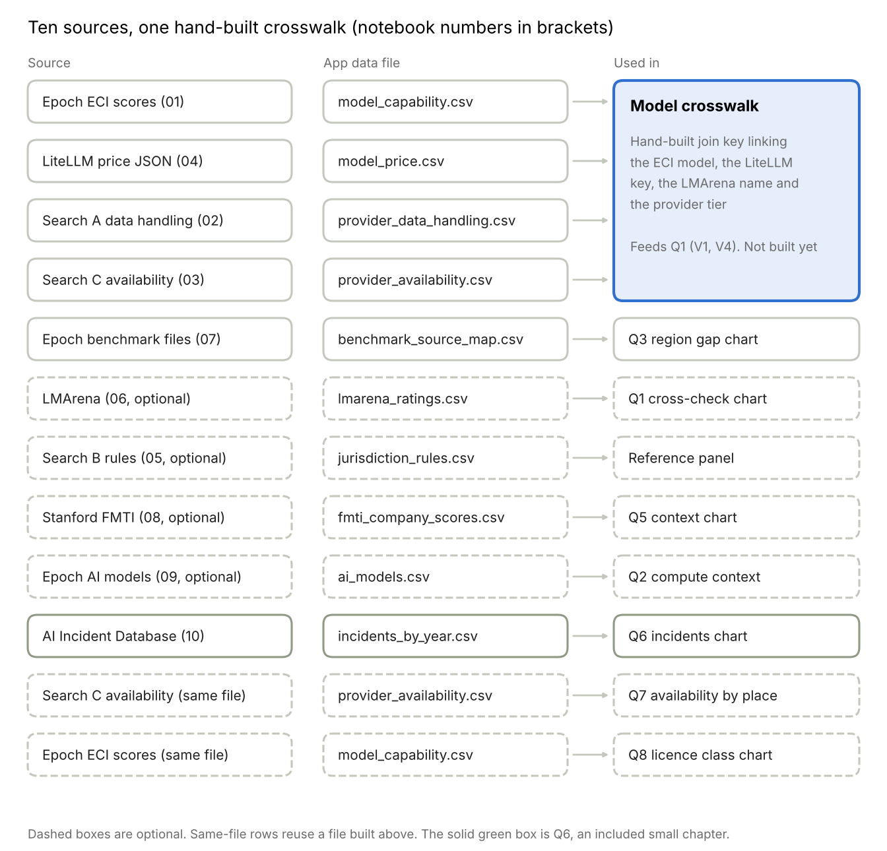

# Dataset Inventory and Ranking from Four Earlier Proposals

Oct 18, 2026 · @Ian

## Answer first

Epoch AI's Capabilities Index (ECI) file is the backbone for the revised topic, and it is already in your Assignment 3 folder with 76 Chinese models in it. Ranking all 20 candidate datasets from the four old proposals and our own searches (re-scored on 18 October 2026), five are compulsory, seven are optional, and eight are dropped. Epoch is the best fit because one file gives capability, developer country and open versus closed weights for the same model.

| Tier       | Datasets (rank order)                                                                                                                                    | Why                                                                         |
|------------|----------------------------------------------------------------------------------------------------------------------------------------------------------|-----------------------------------------------------------------------------|
| Compulsory | 1\. Epoch ECI scores. 2. Search A provider data handling. 3. Search C provider availability. 4. LiteLLM prices. 5. Epoch benchmark files (source column) | Each is the only source we hold for its part of Q1, Q2, Q3 or the cost axis |
| Optional   | 6\. LMArena. 7. Epoch per-benchmark CSVs. 8. Stanford FMTI. 9. Search B jurisdiction rules. 10. AI Incident Database (included for Q6). 11. Regulator pages. 12. Epoch AI models CSV | Each adds a cross-check, context or a small chapter, none is required to answer Q1 |
| Drop       | Wikimedia page views (struck by the team on 18 October 2026), Stack Overflow developer survey, Epoch ChatGPT usage and polling, AIAAIC (not needed), Epoch AI data centers, Ember electricity, OWID and IEA data-centre share | They answer energy or US usage questions, or have been replaced, not ours |

Two gaps remain open, and no old proposal fills them: usage or token share for Q4 (no source, and the team struck Wikimedia page views on 18 October 2026) and a customer-data score for Q5. Update of 18 October 2026: Stanford FMTI (Q5 context) and the AI Incident Database export of 12 October 2026 (Q6) are now held and opened, with notebooks 08 and 10. The new Q8 needs no new file, because the Epoch capability file we hold has accessibility and country columns (277 models, 24 with unknown accessibility). Kaggle copies of benchmark, price and incident data show no owner, licence or source on their pages, so they are used only as pointers to the original sources.

## What the four proposals used

I read 00_Proposals_Overview.md and the four English proposals in your Proposals folder. P4 there is the older China compute efficiency topic, not the revised P4 we are now planning.

| Proposal                           | Question in one line                                                  | Datasets it used                                               | Still relevant to the revised topic             |
|------------------------------------|-----------------------------------------------------------------------|----------------------------------------------------------------|-------------------------------------------------|
| P1 Compute concentration vs access | Is access to frontier-scale models narrowing as compute concentrates? | Epoch AI models CSV, Epoch ECI scores, Epoch AI data centers   | ECI and the models CSV, yes. Data centers, no   |
| P2 Attention vs capability         | Does public attention follow measured capability?                     | Wikimedia page views, Epoch ECI scores, Epoch Benchmarking Hub | ECI and Benchmarking Hub, yes. Page views, weak |
| P3 AI energy geography             | Is AI electricity demand global or local?                             | Epoch AI data centers, Ember, OWID (IEA)                       | None                                            |
| P4 China compute efficiency        | Is China keeping pace with less compute?                              | Epoch models CSV, Epoch ECI scores, optional Benchmarking Hub  | ECI, models CSV and Benchmarking Hub, yes       |

**Already in your folder.** The P2 app's data folder (a3_p2_attention_app/data/raw) holds eci_scores.csv (274 rows), the unzipped Benchmarking Hub (benchmark_data, 88 benchmark metadata rows, 1,158 model metadata rows, 2,898 model-by-benchmark rows in processed_data_for_eci.csv) and pageviews_monthly.csv. Its retrieval_log.json records retrieval on 2026-10-14 16:38 UTC with SHA-256 hashes. The models CSV, data centers, Ember and OWID files were planned but are not in the folder. I only read these files and changed nothing.

## Ranking

Score = 3 x Fit + Held + Licence + Effort, each rated 0 to 3, maximum 18 (same scale as the old proposals). Fit is how directly the dataset answers one of Q1 to Q8. Held is how much of it we have actually opened (3 = rows read from a file we hold). Licence is how clearly we may reuse it. Effort is 3 when little work is needed. Tiers: 15 or more compulsory, 12 to 14 optional, below 12 dropped. Rows were re-scored on 18 October 2026, after the LiteLLM, LMArena, FMTI and AI Incident Database files were held and opened, so Held and Licence rose for those rows. No candidate is on reserve any more. These are my judgements from files and pages I opened, not measurements.

| Rank | Dataset | Fit | Held | Licence | Effort | Score | Tier | Questions served |
|------|---------|-----|------|---------|--------|-------|------|------------------|
| 1    | Epoch ECI scores (eci_scores.csv) | 3 | 3 | 3 | 3 | 18 | Compulsory | Q1, Q2, Q8 |
| 2    | Search A provider data handling (own table) | 3 | 3 | 2 | 3 | 17 | Compulsory | Q1, Q5 |
| 2    | Search C provider availability (own table) | 3 | 3 | 2 | 3 | 17 | Compulsory | Q1, Q2, Q7 |
| 2    | LiteLLM model price JSON | 3 | 3 | 3 | 2 | 17 | Compulsory | Q1 (cost axis) |
| 5    | Epoch benchmark files: processed_data_for_eci.csv, model_metadata.csv, benchmark_metadata.csv | 3 | 3 | 2 | 2 | 16 | Compulsory | Q3, Q2 |
| 6    | LMArena leaderboard dataset | 2 | 3 | 3 | 2 | 14 | Optional | Q1 cross-check, Q2 |
| 6    | Epoch per-benchmark CSVs (88 files in the zip) | 2 | 3 | 3 | 2 | 14 | Optional | Q1 persona benchmarks, Q3 |
| 6    | Stanford FMTI, December 2025 (CC-BY-4.0, opened in notebook 08) | 2 | 3 | 3 | 2 | 14 | Optional | Q5 context |
| 9    | Search B jurisdiction rules (own table) | 2 | 2 | 2 | 3 | 13 | Optional | Q1, Q5 context |
| 9    | AI Incident Database (CC BY-SA 4.0, export of 12 October 2026, notebook 10) | 2 | 3 | 2 | 2 | 13 | Optional, included for Q6 | Q6 |
| 11   | Financial-regulator pages: HKMA, APRA CPG 230, MAS FEAT (opened pages, not files) | 2 | 2 | 1 | 3 | 12 | Optional | Q5 rules note |
| 11   | Epoch AI models CSV (all_ai_models.csv, notebook 09 not yet run on the real file) | 2 | 1 | 3 | 2 | 12 | Optional | Q2 compute context |
| 11   | Wikimedia page views (pageviews_monthly.csv) | 1 | 3 | 3 | 3 | 12 | Dropped by team decision, 18 October 2026 | Q4 weak proxy |
| 14   | Stack Overflow developer survey | 1 | 2 | 2 | 2 | 9 | Drop | Q4 background only |
| 14   | Epoch ChatGPT usage | 1 | 1 | 3 | 2 | 9 | Drop | US panel, not our regions |
| 14   | Epoch polling on AI usage | 1 | 1 | 3 | 2 | 9 | Drop | US workers only |
| 17   | AIAAIC Repository (CC BY-SA 4.0 per OECD entry only) | 2 | 0 | 1 | 1 | 8 | Not needed, AIID covers Q6 | Q6 fallback |
| 18   | Epoch AI data centers | 0 | 2 | 3 | 2 | 7 | Drop | None |
| 19   | Ember electricity | 0 | 1 | 3 | 2 | 6 | Drop | None |
| 20   | OWID and IEA data-centre share | 0 | 1 | 1 | 2 | 4 | Drop | None |

Source links for every dataset in the ranking (added 18 October 2026, same order as the ranking above). Links were checked against notebooks 01 to 07 in the Data folder. Rows marked main site only have no exact address recorded in our earlier work.

| Dataset | Source link | Licence or terms page | Link status |
|---|---|---|---|
| Epoch ECI scores (eci_scores.csv) | https://epoch.ai/data/eci_scores.csv , https://epoch.ai/benchmarks?view=graph&tab=eci | https://epoch.ai/data | Opened |
| Search A provider data handling (own table) | https://claude.ai/code/artifact/3b7002b1-1b18-487e-a827-3891201e23c9 | Provider pages are listed in notebook 02 and in the Search A doc | Opened |
| Search C provider availability (own table) | https://claude.ai/code/artifact/31eae3cc-c885-48b3-9d45-f21d24532783 | Provider pages are listed in notebook 03 and in the Search C doc | Opened |
| Epoch benchmark files: processed_data_for_eci.csv, model_metadata.csv, benchmark_metadata.csv | https://epoch.ai/data/benchmark_data.zip , https://epoch.ai/benchmarks/use-this-data | https://epoch.ai/data | File held |
| LiteLLM model price JSON | https://github.com/BerriAI/litellm/blob/main/model_prices_and_context_window.json | https://github.com/BerriAI/litellm/blob/main/LICENSE | Opened |
| Search B jurisdiction rules (own table) | https://claude.ai/code/artifact/6ca3e9a3-46dd-43a1-8c0d-bd406d868e47 | Sources are listed in notebook 05 and in the Search B doc | Opened |
| LMArena leaderboard dataset | https://huggingface.co/datasets/lmarena-ai/leaderboard-dataset | same page, licence field cc-by-4.0 | Opened |
| Financial-regulator pages: HKMA, APRA CPG 230, MAS FEAT (opened pages, not files) | HKMA https://www.hkma.gov.hk/eng/news-and-media/press-releases/2026/10/20261015-3/ , APRA https://www.apra.gov.au/practice-guides/cpg-230 , MAS https://www.mas.gov.sg/~/media/MAS/News%20and%20Publications/Monographs%20and%20Information%20Papers/FEAT%20Principles%20Final.pdf | HKMA https://www.hkma.gov.hk/eng/other-information/terms-and-conditions-of-use/ , APRA https://www.apra.gov.au/copyright , MAS https://www.mas.gov.sg/terms-of-use (not yet read) | Opened, addresses confirmed by a team member 2026-10-18 |
| Epoch AI models CSV (all_ai_models.csv) | https://epoch.ai/data/all_ai_models.csv , https://epoch.ai/data/ai-models | https://epoch.ai/data | Notebook 09 written, real file not yet downloaded from our environment |
| Epoch per-benchmark CSVs (88 files in the zip) | https://epoch.ai/data/benchmark_data.zip | https://epoch.ai/data | File held |
| Wikimedia page views (pageviews_monthly.csv) | https://wikimedia.org/api/rest_v1/metrics/pageviews/per-article/ | https://dumps.wikimedia.org/other/pageviews/readme.html | File held, dropped by team decision on 18 October 2026 |
| Stanford FMTI, December 2025 (CC-BY-4.0, opened in notebook 08) | https://crfm.stanford.edu/fmti/December-2025 , https://github.com/stanford-crfm/fmti , paper https://crfm.stanford.edu/fmti/December-2025/paper.pdf | LICENSE.md in the repository, CC BY 4.0 (read in fmti-main.zip) | File held |
| AI Incident Database (CC BY-SA 4.0, export of 12 October 2026, notebook 10) | https://incidentdatabase.ai/research/snapshots/ (files on https://pub-72b2b2fc36ec423189843747af98f80e.r2.dev) | https://incidentdatabase.ai/terms-of-use | File held |
| Stack Overflow developer survey | https://survey.stackoverflow.co | address not recorded | Main site only, not opened |
| Epoch ChatGPT usage | https://epoch.ai/data (entry ChatGPT usage, XLSX) | https://epoch.ai/data | Listed on the page, not opened |
| Epoch polling on AI usage | https://epoch.ai/data (entry not located) | https://epoch.ai/data | Listed on the page, not opened |
| AIAAIC Repository (CC BY-SA 4.0 per OECD entry only) | https://www.aiaaic.org/aiaaic-repository | OECD catalogue entry states CC BY-SA 4.0, aiaaic.org itself was blocked to our tool | Main site only, not opened |
| Epoch AI data centers | https://epoch.ai/data (entry AI data centers, ZIP) | https://epoch.ai/data | Listed on the page, not opened |
| Ember electricity | https://ember-energy.org/data/ | address not recorded | Main site only, not opened |
| OWID and IEA data-centre share | https://ourworldindata.org , https://www.iea.org | address not recorded | Main site only, not opened |

**Question coverage after the ranking**

| Question                            | Situation in which the architect asks it (assumed)                                                                                                                   | Primary data                                                                             | Supporting data                                                           | Status and main risk                                                                                                                                         |
|-------------------------------------|----------------------------------------------------------------------------------------------------------------------------------------------------------------------|------------------------------------------------------------------------------------------|---------------------------------------------------------------------------|--------------------------------------------------------------------------------------------------------------------------------------------------------------|
| Q1 headline                         | The risk committee wants an interim approved list within one to two weeks, and the architect must choose which models go on it for the level of data staff will send | Epoch ECI, Search A, Search C, LiteLLM prices                                            | Search B, LMArena                                                         | Feasible once the model crosswalk exists. Hardest, because four sources must be joined                                                                       |
| Q2 capability loss over time        | Before committing, the architect must tell the committee whether waiting for US access is worth it                                                                   | Epoch ECI, benchmark model_metadata.csv                                                  | Epoch models CSV, LMArena                                                 | Covered. Easiest, no join needed                                                                                                                             |
| Q3 independent versus self-reported | The committee is quoting developer claims, and the architect needs to know whether independent tests agree before relying on a number                                | Epoch benchmark file processed_data_for_eci.csv                                          | Epoch per-benchmark CSVs                                                  | Covered, but the independent or self-reported flag is hand-coded                                                                                             |
| Q4 usage                            | Not tied to a situation | None | None (Wikimedia page views struck by the team on 18 October 2026) | No source. Dropped unless a usage source appears. OpenRouter OP.GG rejected on 18 October |
| Q5 disclosure and its effect        | A regulator or auditor asks how the choice was made, and the architect must show what each developer discloses and which rules apply                                 | Search A                                                                                 | Search B, regulator pages (HKMA, APRA, MAS), Stanford FMTI December 2025  | Covered for data handling. FMTI scores how openly a model was built, not what happens to a customer's data, so it adds context and does not replace Search A |
| Q6 incidents                        | Not tied to a situation | AI Incident Database export of 12 October 2026 (CC BY-SA 4.0, notebook 10) | None. AIAAIC is no longer needed | Included as a small chapter. File held and opened: 1,734 incidents, but only 8 name the China-based developers in scope, so it cannot compare regions. OECD AIM and Inhumain rejected |
| Q7 availability by place            | Some staff already use a hosted model, and the architect must check that the provider is really offered where the bank operates                                      | Search C                                                                                 | Search A region choice column                                             | Covered for the providers we coded. Mistral, Meta and Google open-weight models and Hong Kong and Singapore resellers are missing                            |
| Q8 capability by licence class      | The committee asks whether a self-hosted open-weight model may be used commercially, since the data then stays inside the bank                                       | Epoch ECI file, Model accessibility and Accessibility group columns (checked 18 October) | Official licence text for each model (five read)                                      | Data covered (277 models, 24 with unknown accessibility). Licence text read for five open-weight models on 18 October, the other open-weight rows are marked not reviewed                                                                                       |

**Added after Gemini Round 3 (18 October 2026)**

Gemini returned 14 pages and called all of them opened. We opened each one ourselves with our own tools. The table gives what we found, not what Gemini reported.

| Source                                                                                 | What we found                                                                                                                                                                                                                                                                                                                               | Result                                             | Use                                                                    |
|----------------------------------------------------------------------------------------|---------------------------------------------------------------------------------------------------------------------------------------------------------------------------------------------------------------------------------------------------------------------------------------------------------------------------------------------|----------------------------------------------------|------------------------------------------------------------------------|
| Stanford Foundation Model Transparency Index, December 2025, and its GitHub repository | The page lists 13 developers, including Alibaba, DeepSeek, Mistral, Anthropic, OpenAI, Google, Meta and xAI. The repository shows a CC-BY-4.0 licence and the README says all data and visuals are CC-BY. Gemini wrongly said no licence was found. The files were read later in notebook 08 (13 developers, 100 indicators) | Verified for the page, the licence and the files (18 Oct): CC-BY-4.0, 100 indicators by 13 developers | Q5 context only, it measures disclosure of how models are built, not customer data handling                   |
| OECD AI Incidents Monitor                                                              | Copyright line "© 2026 OECD. All rights reserved", no download                                                                                                                                                                                                                                                                              | Rejected for reuse                                 | None                                                                   |
| AIAAIC Repository, OECD catalogue entry                                                | The entry gives the licence as "Creative Commons Attribution Share Alike 4.0 International". aiaaic.org itself is blocked to our tool                                                                                                                                                                                                       | Secondary source only                              | Q6 candidate. Confirm the licence on aiaaic.org                        |
| Inhumain AI incident tracker                                                           | Not an original dataset, it draws on AIAAIC and the AI Incident Database. The full database is only on request and no licence is shown                                                                                                                                                                                                      | Rejected                                           | None                                                                   |
| OpenRouter OP.GG page                                                                  | Token use of one app only, no region and no licence                                                                                                                                                                                                                                                                                         | Rejected                                           | None                                                                   |
| HKMA, "ART" Framework press release, 15 October 2026                                   | Opened. Announces updated supervisory guidance, a training data sharing platform and a coming discussion paper on agentic AI. Copyright "© 2026 Hong Kong Monetary Authority. All rights reserved."                                                                                                                                         | Verified, cite only                                | Q5 regulator note                                                      |
| APRA, CPG 230, June 2024                                                               | Opened. Guidance and not the binding standard, which is CPS 230. Incident notice within 72 hours. Licensed CC BY 3.0 Australia                                                                                                                                                                                                              | Verified                                           | Q5 regulator note                                                      |
| MAS, FEAT principles                                                                   | Opened. Published 12 November 2018 and updated 7 February 2019, Gemini gave only the update date. Binding status not stated                                                                                                                                                                                                                 | Verified                                           | Q5 regulator note                                                      |
| PCPD, AI Model Personal Data Protection Framework                                      | Our tool returned no text from the PDF. A team member later supplied and checked the addresses of both PCPD PDFs (AI protection framework and use of agentic AI), both CC BY 4.0                                                                                                                                                                                                                                                                                                      | Addresses checked by a team member                                         | Q5 regulator note                                                   |
| Epoch AI data page                                                                     | States that data is "free to use, distribute, and reproduce provided the source and authors are credited" under a Creative Commons Attribution licence                                                                                                                                                                                      | Verified                                           | Settles the Epoch licence question for ECI, benchmarks and models data |

Gemini found nothing for Q7, Q8 licence texts or price history, and its Q4 and Q6 leads fail as shown above. It also cited our own brief as a source for several "opened" claims, so its "opened" flag cannot be trusted without a check.

## Dataset cards: compulsory

Same fields as the Search A, B and C docs: what the table is, key fields, how we use it, why, the permission to reuse, and how we reshape it. Counts below come from files in your folder that I opened.

| Dataset and source                                                                                                                       | Table and key fields                                                                                                                                                                                                                                                                                                                                                                                                                                     | Usage in our app                                                                                                                                 | Rationale                                                                                                                      | Authorisation                                                                                                                                                | Restructuring                                                                                                                                                       | Questions |
|------------------------------------------------------------------------------------------------------------------------------------------|----------------------------------------------------------------------------------------------------------------------------------------------------------------------------------------------------------------------------------------------------------------------------------------------------------------------------------------------------------------------------------------------------------------------------------------------------------|--------------------------------------------------------------------------------------------------------------------------------------------------|--------------------------------------------------------------------------------------------------------------------------------|--------------------------------------------------------------------------------------------------------------------------------------------------------------|---------------------------------------------------------------------------------------------------------------------------------------------------------------------|-----------|
| **Epoch ECI scores.** [eci_scores.csv](https://epoch.ai/data/eci_scores.csv), copy in Data/raw/epoch, replaced by a newer hand download on 2026-10-18                    | One row per model, 277 rows, 2023-02-24 to 2026-10-07 (notebook 01). Fields: Model, Display name, eci, eci_ci_low, eci_ci_high, date, Organization, Country (of organization), Model accessibility, Accessibility group, model_versions. Country: US 161, China 76, France 17, UAE 4, Canada 1, UK 1, blank 17. Group: open weights 127, closed weights 126, other 24. China: 63 open, 9 closed, 4 other. Best Chinese score 157.42 (Kimi K3) vs best overall 166.82 (Claude Opus 5.5) | Capability axis of the Q1 ranking and the capability-against-price scatterplot. Q2 step line of best score among open or non-US models over time | One file gives capability, country and access for the same model, with a confidence interval for error bars                    | CC BY 4.0, credit Epoch AI                                                                                                                                   | Snake_case names, keep the interval, add a region_group (US, China, other, unknown), drop model_versions, add retrieval date and source URL from retrieval_log.json | Q1, Q2    |
| **Search A provider data handling.** Our own table, [Search A doc](https://claude.ai/code/artifact/3b7002b1-1b18-487e-a827-3891201e23c9) | One row per provider and tier, 12 rows, 7 providers. Fields: training_default, retention_class, zero_retention_option, storage_location, region_choice, authority_sharing, entity_and_governing_law, policy_date, source_url                                                                                                                                                                                                                                          | Data-control axis of Q1 and the developer comparison in Q5                                                                                       | The only source we hold that ties data handling to named API tiers, each with a link and date                                  | Facts from public provider terms, short quotes only, every row links to its page                                                                             | Already coded. Add a provider_key that joins to the model crosswalk                                                                                                 | Q1, Q5    |
| **Search C provider availability.** Our own table, [Search C doc](https://claude.ai/code/artifact/31eae3cc-c885-48b3-9d45-f21d24532783)  | One row per provider product and place. Fields: status (supported, not_listed, excluded_stated, no_list_found), page_date, date_viewed, source_url                                                                                                                                                                                                                                                                                                       | Filter that removes models not offered in the organisation's region                                                                              | It is the evidence for "unavailable or restricted" in Q1. OpenAI, Anthropic and Google do not list Hong Kong or mainland China | Same as Search A                                                                                                                                             | Pivot to long form with one place column. Add provider_key                                                                                                          | Q1, Q2    |
| **Epoch benchmark files.** Unzipped benchmark_data.zip, [use this data](https://epoch.ai/benchmarks/use-this-data), retrieved 2026-10-14 | processed_data_for_eci.csv: 2,898 rows, 60 benchmarks, 274 models, with performance and a source text (1,270 blank, 872 papers or reports, 756 URLs). model_metadata.csv: 1,158 rows with country, accessibility and training_compute_flop (357 filled, 178 of 277 Chinese rows). benchmark_metadata.csv: 88 rows, 61 used in the ECI                                                                                                                    | Q3 diverging bar of the region gap, split by source class. Q2 compute context                                                                    | The only Epoch file that says where each score came from. Chinese rows exist in all three tables                               | CC BY 4.0 for Epoch's own runs. External results keep their original licence and benchmark questions belong to their creators, so credit the original source | Hand-map each distinct source to independent, developer-reported or unclear in benchmark_source_map.csv. Join country through the ECI Model key (97% of rows match) | Q3, Q2    |
| **LiteLLM price JSON.** BerriAI/litellm model prices file, 47,497 lines, 1.64 MB, current prices only                                    | One entry per model key with per-token prices and context limits. Notebook 04 flattens it into model_price.csv (4,206 rows, of which 2,985 are chat models and 3,384 have an output price)                                                                                                                                                                                                                                                                                                                                                   | Cost axis of Q1 and the price side of the scatterplot                                                                                            | The only price source we hold. Prices are provider list prices                                                                 | MIT, enterprise/ folder excluded (checked 18 October 2026)                                                   | Flatten to a table, convert to US dollars per million tokens, keep the snapshot date, key by provider and model. Match to ECI names by hand in the crosswalk        | Q1        |

## Dataset cards: optional

| Dataset and source                                                                                                                       | Table and key fields                                                                                                                                                                                                           | Usage in our app                                                                                                    | Rationale                                                                                                          | Authorisation                                     | Restructuring                                                                      | Questions          |
|------------------------------------------------------------------------------------------------------------------------------------------|--------------------------------------------------------------------------------------------------------------------------------------------------------------------------------------------------------------------------------|---------------------------------------------------------------------------------------------------------------------|--------------------------------------------------------------------------------------------------------------------|---------------------------------------------------|------------------------------------------------------------------------------------|--------------------|
| **Search B jurisdiction rules.** Our own table, [Search B doc](https://claude.ai/code/artifact/6ca3e9a3-46dd-43a1-8c0d-bd406d868e47)     | One row per place, 4 rows. Fields: law, regulator, cross-border rule, status, AI guidance, penalty headline, source type                                                                                                       | A reference panel next to the data-control axis, not a score                                                        | Explains why a region cares about where data goes, but it is not per model and most sources are law-firm summaries | Public law and commentary, linked, no long quotes | Add jurisdiction_rules.csv with source_type and date_viewed as in the doc          | Q1, Q5, Q6 context |
| **LMArena leaderboard dataset.** lmarena-ai/leaderboard-dataset on Hugging Face                                                          | Notebook 06 output has 11,033 rows. Columns rating, rating_lower, rating_upper, variance, vote_count, rank. 23 subsets, splits full and latest, latest 2026-10-14                                                                                                  | Cross-check: do ECI and human-preference rankings agree on the accessible models                                    | Independent second view of capability, but it measures preference and has no country or access field               | cc-by-4.0, credit LMArena                         | Take one text subset from the latest split, match model names to the crosswalk     | Q1, Q2             |
| **Epoch AI models CSV.** [all_ai_models.csv](https://epoch.ai/data/all_ai_models.csv), updated daily                                     | About 57 columns including Country (of organization), Model accessibility, Training compute (FLOP), Training compute cost (2023 USD), Confidence. Not in your folder. Notebook 09 downloads it or reads a copy saved in Data/raw/epoch, and has only been tested on a made-up table | Compute and cost context for Q2                                                                                     | ECI and model_metadata.csv already carry country, access and most compute, so the gain is small                    | CC BY 4.0, credit Epoch AI                        | Keep about 12 columns, drop free-text fields                                       | Q2                 |
| **Epoch per-benchmark CSVs.** 88 files in the unzipped hub, for example swe_bench_verified.csv (35 rows) and gpqa_diamond.csv (323 rows) | Model version, mean_score, Best score, Release date, Organization, Country, Training compute, stderr                                                                                                                           | Persona sliders on one benchmark, for example SWE-bench Verified for a coding-heavy role, with stderr as error bars | Chinese models appear in these files, for example GLM, Qwen, Kimi and DeepSeek in the SWE-bench file               | As the benchmark files above                      | One tidy table of model, benchmark, score, stderr for the few benchmarks we choose | Q1, Q3             |
| **Wikimedia page views.** pageviews_monthly.csv, 15 KB, retrieved 2026-10-14                                                             | Article, month, views                                                                                                                                                                                                          | A weak proxy for attention to named models                                                                          | Page views are attention, not usage, so Q4 stays a gap. The team struck it on 18 October 2026 and it is no longer used                                                             | CC0                                               | Keep as is                                                                         | Q4                 |
| **Stanford FMTI.** [December 2025](https://crfm.stanford.edu/fmti/December-2025), GitHub zip, notebook 08 | 13 developers by 100 indicators (1,300 rows) plus company scores and indicator text. Fields: developer, indicator, score, domain, hq_country, is_china_based (our annotation) | Context bar chart beside the Q5 chapter, for example IBM 95 and Writer 72 against DeepSeek 32 and Alibaba 26 | Scores how openly a model was built, not how customer data is handled, so it adds context and does not replace Search A | CC-BY-4.0, credit Stanford CRFM | Notebook 08 reads the zip, checks the report scores equal the table scores and saves three tables | Q5 context |
| **AI Incident Database.** [weekly export of 12 October 2026](https://incidentdatabase.ai/research/snapshots/), Excel, notebook 10 | 1,734 incidents and 3,068 incident-developer rows. Fields: incident id, date, alleged developer text, deployer, harmed party. We classify entities, flag China-based developers and add a keyword flag for generative-AI-related incidents (a lower bound) | V8 chart of reported incidents per year (109 in 2022, 457 in 2025, 257 in 2026 to 3 October) and by developer since 2022 | Fills Q6. Only 8 incidents name DeepSeek, Alibaba, Z.ai or Moonshot, against 190 for OpenAI, so it shows rising reports and cannot compare regions | CC BY-SA 4.0 for the database collections, not for the report text, submissions or media, and the terms bar selling or commercially exploiting the site | Split developer text on commas, classify entities, keep incident-level fields only | Q6 |

## Merge plan

We build a new Assignment 3 app folder in the Assignment 2 Part C layout (data/raw, data/sample, data/processed, docs/data_dictionary.md, docs/provenance_matrix.md, src/data.py). We copy the Epoch files from the P2 folder into it and leave the P2 folder untouched.

merge plan: 10 sources, 1 crosswalk

Each source becomes one app file. Notebooks 01 to 10 in the Data folder build most of them. The first four feed one hand-made crosswalk, because ECI model names, LiteLLM keys and provider tiers do not share an identifier. FMTI, the Epoch models table and the AI Incident Database stand alone and need no crosswalk. Q7 and Q8 need no new file. Q7 reads provider_availability.csv and Q8 reads model_capability.csv, using its accessibility columns.

| App file                          | Built from                 | Key columns                                                                                                                                                              |
|-----------------------------------|----------------------------|--------------------------------------------------------------------------------------------------------------------------------------------------------------------------|
| model_capability.csv              | ECI scores                 | model_key, display_name, eci, eci_ci_low, eci_ci_high, release_date, organization, country, region_group, accessibility, accessibility_group, source_url, date_retrieved |
| model_price.csv                   | LiteLLM price JSON         | litellm_key, provider, input_usd_per_million, output_usd_per_million, max_input_tokens, snapshot_date, source_url                                                        |
| provider_data_handling.csv        | Search A                   | The Search A schema plus provider_key                                                                                                                                    |
| provider_availability.csv         | Search C                   | The Search C schema plus provider_key                                                                                                                                    |
| model_crosswalk.csv               | Hand-built                 | model_key, litellm_key, provider_key, lmarena_name, match_note (exact, close, none)                                                                                      |
| benchmark_source_map.csv          | Epoch benchmark files      | source_text, source_class (independent, developer_reported, unclear), rule_used                                                                                          |
| benchmark_scores_tidy.csv         | processed_data_for_eci.csv | model_key, benchmark, performance, source_class, country                                                                                                                 |
| lmarena_ratings.csv (optional)    | LMArena                    | model_name, rating, rating_lower, rating_upper, vote_count, rank, split_date                                                                                             |
| fmti_company_scores.csv, fmti_indicator_scores.csv (optional) | Stanford FMTI | developer, total_score, upstream_score, model_score, downstream_score, rank, hq_country, is_china_based |
| ai_models.csv (optional)          | Epoch AI models CSV        | model, organization, country, publication date, accessibility, training compute, has_compute, is_china_based |
| incidents.csv, incident_developers.csv, incidents_by_developer_year.csv, incidents_by_year.csv | AI Incident Database | incident_id, date, developer, entity_class, is_china_based, genai_flag |
| jurisdiction_rules.csv (optional) | Search B                   | place, law, regulator, cross_border_rule, status, source_type, date_viewed                                                                                               |

## Dataset issues found in testing (18 October 2026)

The same list is in the Final Proposal. It comes from running notebooks 01 to 10 on the files we hold.

| # | Issue found in testing | Datasets affected | Effect on questions | What we do |
|---|------------------------|-------------------|---------------------|------------|
| 1 | Model names differ across sources. Exact-name matches of the 277 ECI models reach 186 (LiteLLM), 77 (LMArena) and 122 (benchmark files), and for the top 50 models only 49, 24 and 12 | ECI, LiteLLM, LMArena, benchmark files, Search A | Q1 most, also Q3 | Build the crosswalk by hand, show the match rate on screen, plot only matched models |
| 2 | One publisher sits under most numbers | ECI, benchmark files, Epoch models CSV | Q1, Q2, Q3, Q8 | Say so on screen, use LiteLLM and LMArena as independent views |
| 3 | Hand-coded tables are small and go stale (Search A 12 rows, Search C 28, Search B 4 places) | Search A, B, C | Q1, Q5, Q7 | Show the page date on every row, recheck before submission, say "coded from the page of [date]" |
| 4 | Many fields are empty or "not stated": about half of Search A fields, retention days missing for 83 percent of rows, 16 of 28 Search C rows "no list found", LiteLLM supported_regions empty for 99.6 percent | Search A, Search C, LiteLLM | Q5, Q7, Q1 | Show them as their own class and never as pass or fail. Do not use the LiteLLM region field |
| 5 | The source column that separates independent from self-reported scores is not kept in notebook 07 (in the 2,898-row processed_data_for_eci.csv, 1,270 blank, 872 paper or report, 756 URL) | Benchmark files | Q3 | Add the column back, build the source map by hand, drop Q3 to a smaller chart if coverage is thin |
| 6 | 17 of 277 ECI rows (6.1 percent) have no organisation or country | ECI | Q2, Q8 | Name-based China fallback, label the rest unknown |
| 7 | Licence text read for five open-weight models only, 150 rows are not reviewed, and Epoch's label can differ from the licence (Kimi K3) | ECI, licence pages | Q8 | Read more licence texts, show Epoch's label beside ours, state it is not legal advice |
| 8 | LiteLLM gives current API list prices only. It has no price history and no self-hosting cost | LiteLLM | Q1 | State on screen that price means API list price |
| 9 | AIID country code is filled for 143 of 1,734 incidents (about 8 percent), none for Hong Kong and 4 for China. Developers are alleged, names are free text, 2026 is partial, and only 8 incidents name the China-based developers in scope | AI Incident Database | Q6 | No regional map and no regional comparison, show rising reports only |
| 10 | FMTI scores how openly a model was built, not how customer data is handled | Stanford FMTI | Q5 | Context only, never a data-control score |
| 11 | No usage source after Wikimedia page views were struck | None | Q4 | Drop Q4 unless a source is found |
| 12 | Downloads from epoch.ai, Hugging Face, the GitHub archive and the AIID host are blocked from our cloud environment, and notebook 09 has only run on made-up data | Epoch models CSV, LMArena, FMTI, AIID | Q2 context | Run on a team machine and save files by hand under Data/raw if blocked |

If Searches A, B and C were all given up, Q7 would disappear, Q5 would lose its core and the data gate and availability layers of Q1 would go, so the core question would have to be reworded around self-hosting feasibility. The persona and the three-story structure can stay. The group can decide this with the separate Alternative Proposal (No Search ABC), which is written on the same template.

## Caveats

- **The scores are my judgement.** Fit, Held, Licence and Effort are my ratings from files and pages I opened. Change a rating and the tier may change.

- **The ECI copy was replaced on 18 October 2026.** The first copy was retrieved on 2026-10-14 16:38 UTC, and a newer hand download (to 7 October 2026) now sits in Data/raw/epoch. Refresh before submission and keep the log.

- **Epoch is one publisher.** ECI, the benchmark files and the models CSV all come from Epoch AI, so one publisher's methods sit under most numbers. LiteLLM and LMArena give independent views of price and preference.

- **Source classes for Q3 are not clean.** The source text mixes developer technical reports with third-party leaderboards such as the Stanford CRFM leaderboard. My counts (1,270 blank, 872 papers or reports, 756 URLs) are a rough split, so Q3 needs the hand-made source map. A blank source may mean an Epoch run or simply no attribution.

- **Some accessible options are not covered by Search A or C.** ECI holds 16 French-developer models and 45 US open-weight models, and we have no provider terms or country lists for those developers. We either extend Search A and C or state that scope.

- **Closed weights means API only.** Chinese closed-weight models such as Qwen 3.8 Max and GLM-5.3 are offered through APIs, so their data handling comes from Search A rows, not from open-weight self-hosting.

- **17 ECI rows have no country.** They stay in totals and are labelled unknown. A name-based China fallback is planned.

- **Not verified.** The Epoch AI models CSV (notebook 09 has not yet run on the real file), the MAS general terms (address recorded, text unread) and the Creative Commons version on the Epoch ECI chart page (the benchmarking about page states CC BY 4.0). Licences rechecked on 18 October: LiteLLM MIT (enterprise/ folder excluded), LMArena cc-by-4.0, Wikimedia CC0, FMTI CC-BY-4.0, the AI Incident Database CC BY-SA 4.0 for its database collections only, not for the reports text field, submissions or displayed media, with terms that bar selling or commercially exploiting the site, and both PCPD PDFs CC BY 4.0 (addresses checked by a team member).

- **Counts come from your files.** I profiled the staged copies with a script and did not recheck them against epoch.ai.

## References

**Files in your folder (read only, 2026-10-16)**

1.  Assignment 3/Proposals/00_Proposals_Overview.md, P1_Compute_Concentration_vs_Access.md, P2_Benchmark_Saturation.md, P3_AI_Energy_Geography.md, P4_China_Compute_Efficiency.md

2.  a3_p2_attention_app/data/raw/eci_scores.csv (274 rows) and retrieval_log.json (retrieved 2026-10-14 16:38 UTC)

3.  a3_p2_attention_app/data/raw/benchmark_data/: README.md, benchmark_metadata.csv, model_metadata.csv, gpqa_diamond.csv, mmlu_external.csv, swe_bench_verified.csv, hle_external.csv, epoch_capabilities_index/processed_data_for_eci.csv, epoch_capabilities_index/edi_scores.csv

4.  a3_p2_attention_app/docs/data_dictionary.md, docs/provenance_matrix.md

**Pages opened today**

5.  Epoch AI data hub, licence and update dates: https://epoch.ai/data

6.  Epoch AI, Capabilities and benchmarking, use this data: https://epoch.ai/benchmarks/use-this-data

7.  Epoch AI, Capabilities and benchmarking: https://epoch.ai/benchmarks

8.  Epoch AI, Data on AI models documentation and records: https://epoch.ai/data/ai-models-documentation and https://epoch.ai/data/ai-models-documentation/records

9.  Epoch AI, Data on AI models page: https://epoch.ai/data/ai-models

10. Epoch AI, AI companies: https://epoch.ai/data/ai-companies

11. Epoch AI models CSV (reader summary only, truncated): https://epoch.ai/data/all_ai_models.csv

**Our own tables**

12. Search A: https://claude.ai/code/artifact/3b7002b1-1b18-487e-a827-3891201e23c9

13. Search B: https://claude.ai/code/artifact/6ca3e9a3-46dd-43a1-8c0d-bd406d868e47

14. Search C: https://claude.ai/code/artifact/31eae3cc-c885-48b3-9d45-f21d24532783

**Checked in an earlier session, not reopened today**

15. LiteLLM model prices (BerriAI/litellm), LMArena leaderboard dataset (lmarena-ai/leaderboard-dataset), Stack Overflow developer survey (StackExchange/Survey)

**Added on 18 October 2026**

16. Stanford FMTI, December 2025: https://crfm.stanford.edu/fmti/December-2025 and https://github.com/stanford-crfm/fmti

17. AI Incident Database snapshots: https://incidentdatabase.ai/research/snapshots/

18. PCPD, AI protection framework: https://www.pcpd.org.hk/english/resources_centre/publications/files/ai_protection_framework.pdf and use of agentic AI: https://www.pcpd.org.hk/english/resources_centre/publications/files/pcpd_use_of_agentic_ai.pdf

19. Notebooks 01 to 10 in the Data folder, with the first-pass charts in Data/q_charts
